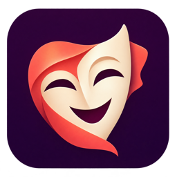
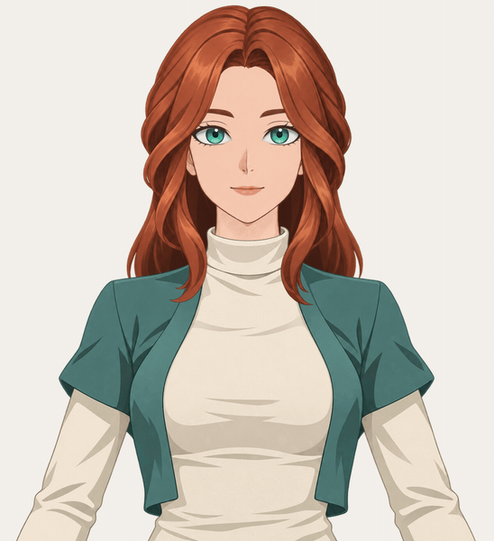

# Лицедей



**Лицедей — открытый редактор 2D-персонажей с послойной графикой, деформацией сеток, анимацией, захватом лица и подключением генеративных нейросетей.**

Разделите рисунок на слои, задайте формы движения, соберите анимацию и проверьте мимику через камеру. Лицедей развивается как инструмент для обучения и собственных персонажей. Текущая версия **0.4 — рабочий прототип**, которому ещё нужны улучшения интерфейса и инструментов сборки.

[Статья о возможностях и устройстве Лицедей](docs/experiment-ru.md) · [Первое движение](docs/first-steps.md) · [Лицензии компонентов](THIRD_PARTY.md)

Главная идея — дать одному автору возможность пройти весь путь от внешности персонажа до анимированного аватара. Пользователь выбирает образ, управляет деталями и исправляет результат, а автоматизация постепенно берёт на себя повторяющиеся операции. Программа бесплатная; услуги внешних AI-провайдеров могут быть платными.

## Пример: Мира



Графика Миры подготовлена с помощью нейросети, а движения настроены и отрендерены существующим ядром Лицедей: дыхание, моргание, взгляд, небольшой наклон головы и запаздывание прядей. Это реальная анимация послойной модели. Сборку и рендер выполнил AI-ассистент скриптами эксперимента; встроенного полного авторига и кнопки экспорта видео в версии 0.4 пока нет.

**[Скачать редактируемую Миру](docs/examples/Mira-demo-light.l2dstudio.zip?raw=true)** · [Смотреть MP4](docs/media/mira-demo-light.mp4) · [Проверки и ограничения](docs/examples/mira-demo-light-report.md)

После запуска Лицедей импортируйте архив `.l2dstudio.zip` и включите воспроизведение. Пример содержит 18 рисунков, 20 слоёв с двумя масками, 9 параметров и петлю на 9 секунд. Рот использует две художественные формы; фонемный липсинк и объёмный поворот головы этот пример не демонстрирует.

## Способы работы и направление развития

- **Вручную:** редактировать слои, сетки, мимику и анимацию через интерфейс.
- **С нейросетями:** получать рисунки через подключённых провайдеров и собирать из них модель. В эксперименте с Мирой подготовка деталей и сборка дополнительно выполнялись ассистентом; это ещё не единый автоматический процесс внутри приложения.
- **Через MCP — в плане разработки:** задавать ассистенту действия словами, например «настрой моргание» или «проверь повороты», через инструменты самого редактора. MCP-сервер редактора пока не реализован.

Цель — первый базовый аватар за рабочий день без обязательного привлечения отдельной команды. Этот срок ещё предстоит подтвердить испытаниями. Универсальная сборка персонажа, сложные повороты головы и расширенная анимация тела остаются задачами развития. Экспорт нативных `.cmo3` и `.moc3` пока не реализован.

Проект ранее назывался Kadr. На исторических скриншотах и в демонстрационных архивах сохранено прежнее название; форматы и существующие проекты совместимы.

## Что работает

- PNG, JPG, WebP и растровые RGB PSD, 8 бит на канал; порядок, видимость, прозрачность, поиск и копирование слоёв.
- Редактируемые треугольные сетки, несколько выбранных вершин, мягкое влияние, вставка точки и уплотнение с переносом ключевых форм.
- Вложенные вращательные и сеточные деформеры; обычные, инвертированные и служебные маски.
- Параметры движения, ключевые формы и поправки сочетаний. Мастерская из девяти поз, сравнение контура и диагностика сетки.
- Мастер сборки глаз из подготовленных деталей: независимое моргание и взгляд.
- Дорожки параметров, линейная, плавная и ступенчатая интерполяция; простая пружинная физика и её запись в экспорт анимации.
- Локальный предпросмотр лицевого захвата: моргание, взгляд, рот, брови, наклон и приблизительный горизонтальный поворот головы. Нужны настроенные формы соответствующих параметров.
- Подключения fal и ComfyUI для получения изображений, очередь и история задач. Платные облачные вызовы оплачиваются отдельно; редактор работает без AI-подключения.
- Отмена и повтор, автосохранение, копия проекта, обнаружение конфликта сохранения.
- Собственный ZIP-проект с ресурсами, PNG текущей позы, PSD растровых слоёв, JSON-анимации и выражения.

## Запуск из исходников

Проверенная среда — macOS, Python 3.9.6 и Node.js 20 для тестов. Для этих зафиксированных зависимостей используйте Python **3.9–3.12**. Для обычного запуска Node.js не нужен. Интерфейс открывается в современном настольном браузере; камера использует WebAssembly, Worker и OffscreenCanvas. Полной проверки Windows/Linux пока нет.

Скачайте исходники, откройте терминал в папке проекта и выполните:

```sh
python3 -m venv .venv
.venv/bin/python -m pip install -r requirements.txt
.venv/bin/python server.py
```

Откройте [Лицедей на этом компьютере](http://127.0.0.1:18321/). Остановить сервер — `Ctrl+C` в терминале. При первом запуске автоматически создаётся новый геометрический бот: нажмите ▶ и попробуйте параметры глаз и рта.

После установки зависимостей на macOS можно запускать `Start.command` или `.venv/bin/python launch.py`: сервер продолжит работать после закрытия вкладки. Для первого знакомства проще запуск в терминале.

Если порт занят другой копией редактора:

```sh
.venv/bin/python server.py --port 18322
```

В этом случае откройте `http://127.0.0.1:18322/`. Можно отдельно задать `--data /path/to/workspace`, `--config /path/to/settings.json` и `--no-seed` для пустого рабочего пространства. У двух одновременно работающих серверов должны быть разные папки данных.

## Где лежат проекты

`data/` создаётся при запуске и содержит проекты, изображения, экспорты, историю задач и резервные копии. Настройки подключений по умолчанию находятся в `data/settings.json`. Эта папка исключена из Git. Для переноса отдельной модели используйте «Экспорт → Проект со всеми ресурсами».

Исторические идентификаторы формата `l2d-ai-studio/1`, `l2d-ai-studio/2` и расширение `.l2dstudio.zip` сохранены для открытия существующих проектов Лицедей. Переименование приложения не преобразует и не удаляет пользовательские файлы.

Камера включается действием пользователя. Кадры обрабатываются локально и не сохраняются. fal получает запрос и выбранный референс только при запуске соответствующей генерации. Ключ можно задать в «Подключениях» или переменной окружения `FAL_KEY`; не включайте его в проекты, коммиты и обращения об ошибках.

## Ограничения 0.4

- Цельный рисунок не разделяется автоматически на готовые части; универсальных мастеров головы, рта и тела ещё нет.
- Девять поз помогают редактировать формы, но сами не создают объёмный поворот головы.
- Нет костей с весами и IK, цепочек физики, произвольной правки рёбер и кривых с ручками Безье.
- Нет записи камеры в анимацию, вертикального угла головы, захвата рук/тела, звуковой дорожки и экспорта видео.
- PSD переносит рисунок, но не риг. JSON движения требует модели с теми же параметрами и не содержит геометрию. Экспорта готового исполняемого аватара нет.
- PSD-группы уплощаются; сложные маски и эффекты нуждаются в подготовке. Холст — до 4096 × 4096, до 100 слоёв и параметров, 1000 вершин на слой, анимация — до 120 секунд.
- Панели пока тесны на небольших экранах. Для работы удобнее окно около 1440 × 900.

## Проверка и разработка

Установите Node.js 20+ для тестов общей геометрии Python/JavaScript:

```sh
.venv/bin/python -m unittest discover -s tests -v
```

Тесты используют временные проекты и не вызывают платные AI-сервисы. Камеру и платную генерацию проверяют отдельно вручную.

`studio/` — модель, геометрия, хранение, импорты, экспорт и AI; `web/` — интерфейс и отрисовка; `server.py` — локальный HTTP API; `tests/` — проверки; `tools/model_builder.py` — командный интерфейс мастера глаз. Учебный рисунок создаётся в `studio/demo.py` из простых геометрических фигур без личных изображений и внешних референсов.

На macOS с установленными инструментами Xcode:

```sh
.venv/bin/python build_app.py
```

Это создаёт локальный неподписанный `Лицедей.app` рядом с исходниками. Он использует эту папку и `.venv`; **это ещё не автономный установщик**.

## Лицензия

Собственный код Лицедей, статья и учебный пример распространяются по [MIT](LICENSE). Сторонние компоненты сохраняют свои лицензии и авторство — см. [THIRD_PARTY.md](THIRD_PARTY.md). Ошибки и предложения можно описывать в Issues этого репозитория; прикладывайте минимальный пример без ключей и личных материалов.
