# Лицедей — как я делаю бесплатный редактор живых 2D-персонажей

Мне хотелось получить понятную программу, в которой можно взять рисунок персонажа, подготовить его к движению и постепенно оживить: закрыть глаза, повернуть голову, открыть рот, добавить покачивание волос. Чтобы каждое действие было видно на холсте, а начать можно было с нескольких деталей и одного ползунка.

Так появился Лицедей — мой эксперимент с самостоятельным локальным редактором 2D-персонажей. Его направление — бесплатный инструмент с открытым исходным кодом, удобный для обучения и собственных проектов. Сейчас это рабочий прототип версии 0.4: основа редактирования уже действует, а удобство интерфейса и полный путь до готового персонажа ещё развиваются.

Ниже — что в нём есть, как связаны инструменты и какой результат можно получить уже сейчас. [Подробный процесс создания Миры — 15 скриншотов и анимация](mira-process-ru.md). Обзорные экраны показывают инструменты на простом демонстрационном боте, а подробный разбор — весь процесс создания и проверки Миры в работающем редакторе.

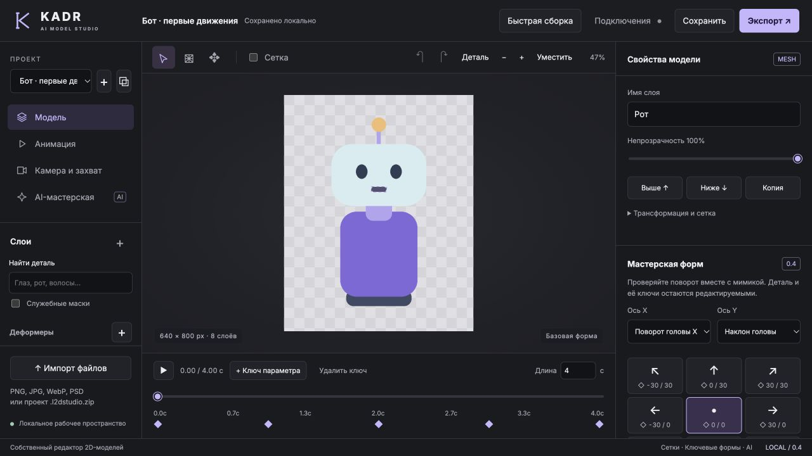

*Рабочий экран: слои слева, персонаж на холсте, свойства и формы справа, шкала времени снизу. Это реальный интерфейс прототипа.*

## От отдельных рисунков к модели

Персонаж состоит из слоёв. Например, голова, волосы, белки глаз, радужки, веки и рот могут быть отдельными изображениями. Такое разделение позволяет двигать одну деталь, сохраняя остальные на месте.

Лицедей принимает PNG, JPG, WebP и подготовленные PSD с растровыми слоями. Для PSD поддерживается RGB с глубиной 8 бит на канал; размер импортируемого изображения ограничен 4096 × 4096 пикселями. Сложные эффекты, некоторые маски, группы и режимы смешивания требуют упрощения перед импортом.

Слои можно переименовывать, копировать, скрывать, переставлять выше или ниже и менять их прозрачность. Поиск помогает найти нужную деталь в большой модели. Служебные маски можно убрать из основного списка, чтобы они не мешали работе с рисунком.

Готовую цельную картинку программа пока не превращает в полностью разобранного персонажа автоматически. Подготовка деталей остаётся самостоятельным этапом.

## Как рисунок начинает двигаться

На изображение накладывается сетка из вершин и треугольников. В начале у слоя есть регулярная сетка 5 × 5 вершин. Когда вершины перемещаются, изображение растягивается и изгибается вместе с ними.

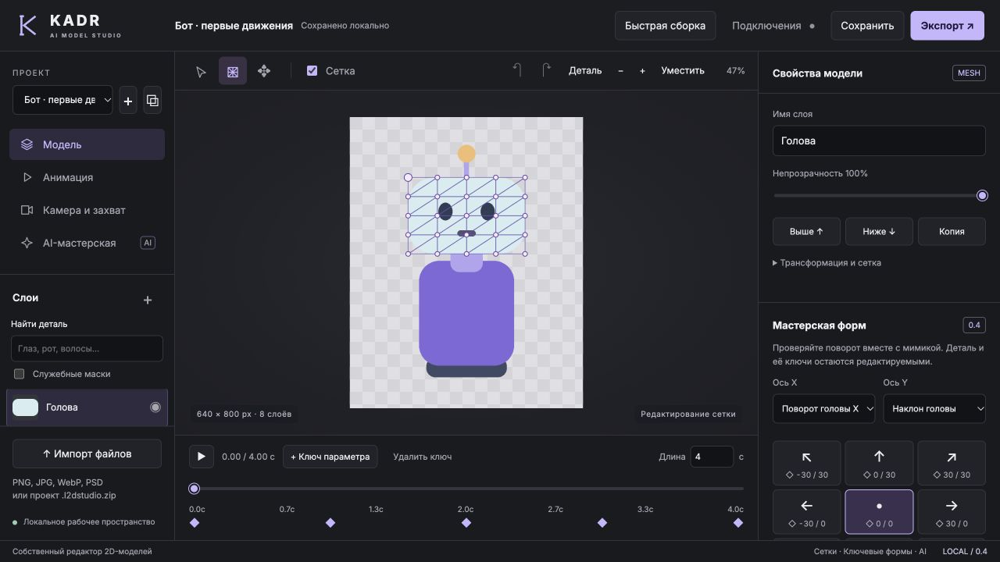

*Выбран слой головы и включено редактирование вершин. Сетка определяет, как изображение будет деформироваться.*

Это позволяет приподнять щёку, изменить линию века или слегка согнуть прядь. Можно двигать весь слой, вращать и масштабировать его либо редактировать отдельные точки.

Для более точной работы есть выделение нескольких вершин через Shift и мягкое влияние: вместе с выбранной точкой постепенно смещаются соседние. Внутрь треугольника можно добавить новую точку, а сетку — уплотнить. При этом сохраняются привязка рисунка и уже созданные формы движения. Удаление точек пока ограничено внутренней вершиной с тремя соседями.

Холст поддерживает приближение к курсору, перемещение и фокус на выбранной детали. Инструмент перемещения включается клавишей V, редактирование сетки — M, перемещение холста — H. Стрелки смещают выбранную деталь на один пиксель, а с Shift — на десять. Изменения можно отменять и возвращать.

## Параметр — ползунок, который управляет формой

Чтобы не двигать вершины вручную каждый раз, форму связывают с параметром. У него есть имя, диапазон и исходное значение. Можно использовать подготовленные параметры или добавить собственные.

Простой пример — моргание. В одном положении глаз открыт, в другом закрыт. Автор задаёт нужные формы сетки, а редактор рассчитывает промежуточные положения при движении ползунка.

Так же настраиваются улыбка, открытие рта, наклон головы или движение одежды. Прозрачность тоже может зависеть от параметра: например, открытый глаз постепенно уступает место отдельно нарисованному закрытому веку.

Важно, что добавленный ползунок ещё не создаёт движение. Формы нужно задать и проверить. Несколько параметров могут действовать одновременно; их независимые изменения суммируются, а сложные сочетания можно поправить отдельно.

## Общие движения через деформеры

Если повернуть голову, глаза, нос и рот должны последовать за ней. Для этого есть деформеры — управляющие объекты, к которым привязываются детали.

Вращательный деформер отвечает за поворот и масштаб. Сеточный позволяет изгибать целую область. Их можно вкладывать друг в друга: общий наклон корпуса, внутри него движение головы, а внутри головы — отдельное движение глаза.

В новом режиме вращения угол и масштаб рассчитываются раздельно, чтобы деталь не уменьшалась непреднамеренно между опорными положениями. Сеточный деформер можно уплотнять до 8 × 8 ячеек.

При смене родителя редактор старается сохранить текущую позу детали. Если родитель нелинейно изогнут и безопасно выполнить действие нельзя, программа предлагает сначала вернуться в нейтральное положение. Последующее движение уже следует новой иерархии.

## Маски и проверка сочетаний

Маска определяет, где деталь должна быть видна. Например, радужка остаётся внутри белка глаза даже при движении взгляда. Поддерживаются обычные и инвертированные маски, а также служебные слои, которые участвуют только в обрезке.

Для сочетания двух параметров есть «Мастерская форм». Она показывает девять опорных поз: центр, края и углы выбранных диапазонов. Это помогает проверить, что происходит, когда персонаж одновременно поворачивает голову и меняет выражение лица.

В выбранной позе можно записать дополнительную поправку. Есть проход по направлениям, сохранение контура предыдущей позы для сравнения и проверка сжатых или перевёрнутых треугольников. Автоматическая диагностика помогает найти проблемную сетку, а края рисунка и выразительность движения всё равно нужно оценивать глазами.

Рисунок слоя можно заменить, сохранив его сетку и формы. После замены важно проверить совмещение: новая картинка может отличаться пропорциями.

## Быстрая сборка глаз

В редакторе уже есть первый специализированный мастер. Он собирает основу моргания и взгляда из подготовленных слоёв.

Для каждого глаза нужно назначить белок, радужку, верхнее веко и закрытую форму. Нижнее веко добавляется при наличии. После проверки схемы программа создаёт отдельную модель с масками, четырьмя параметрами глаз и демонстрационной анимацией.

Исходный проект сохраняется. Полученный результат можно редактировать дальше: поправлять промежуточные формы, амплитуду взгляда и положение деталей. Этот шаблон работает с глазами; голову, рот, волосы и тело он целиком не собирает.

## Анимация и простая физика

У параметров есть независимые дорожки на шкале времени. Можно поставить ключ только для выбранного параметра или записать всю текущую позу. Время и значение ключа редактируются численно; график помогает увидеть изменение.

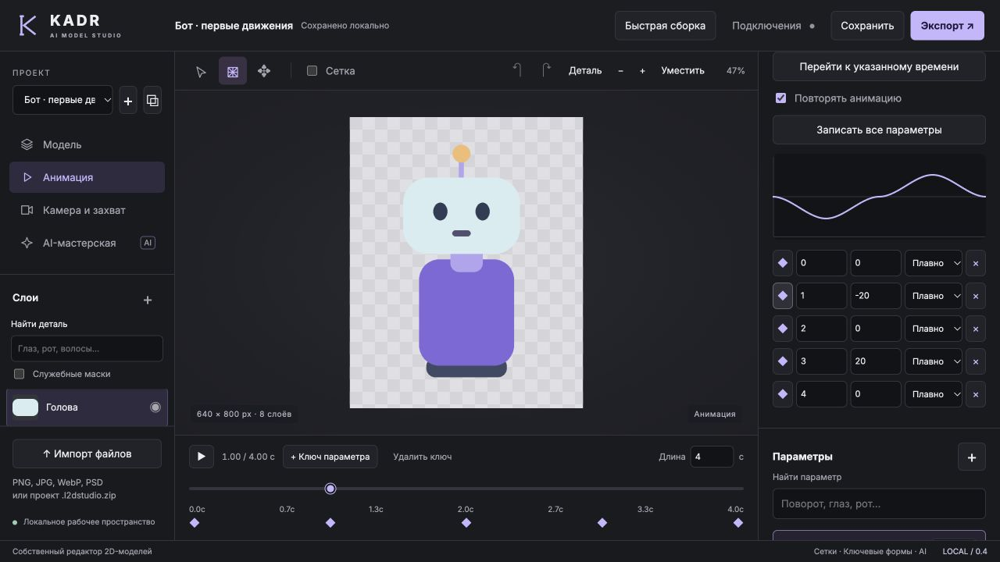

*На первой секунде выбрана поза поворота. Справа видны значения ключей и кривая изменения параметра; внизу — положение на общей шкале времени.*

Между ключами доступны линейный, плавный и ступенчатый переходы. Настраиваются длительность, частота кадров и повтор воспроизведения.

Для вторичного движения есть пружинная физика с настройками частоты, затухания и силы. Она позволяет добавить запаздывание или покачивание, если выходной параметр уже связан с формами модели. Рассчитанное движение можно записать в анимационные ключи. Пока это независимые пружины; сложных цепочек волос и одежды нет.

## Управление выражением лица через камеру

В программе реализован локальный предпросмотр лицевого захвата. После включения камеры пользователь запоминает нейтральную позу и может настроить чувствительность и сглаживание.

Распознавание связывает моргание, взгляд, открытие рта, брови и наклон головы с параметрами модели. Для видимого результата эти параметры должны иметь настроенные формы. Поворот головы влево-вправо оценивается по глубине лицевых ориентиров. Вертикальный поворот, а также захват тела и рук пока не подключены.

Модуль работает локально; видео и точки лица не записываются на диск и не отправляются AI-провайдерам. Захват используется для предпросмотра и не переписывает авторские анимационные дорожки. Записи выступления в анимацию пока нет.

## AI-мастерская для получения изображений

Лицедей умеет подключаться к облачному сервису fal и локальному ComfyUI. В интерфейсе есть очередь генерации и история запросов.

Через облачное подключение можно получать изображения по тексту; работа с референсом зависит от выбранной модели и поддерживаемых ею входных данных. Для локальной генерации предусмотрен простой граф, а более сложный процесс можно подключить через собственный API-граф.

Полученный рисунок затем добавляется в проект и подготавливается к движению. Генерация сама по себе пока не разделяет персонажа на детали, не дорисовывает скрытые области и не создаёт полный риг.

Редактор бесплатный; для подготовленной открытой поставки выбрана лицензия MIT. Внешняя облачная генерация может оплачиваться отдельно по условиям выбранного сервиса. Обычная работа со слоями, сетками и анимацией не требует такого подключения.

## Эксперимент: как AI-помощник собирает Миру

Мы поручили AI-помощнику подготовить нового персонажа, собрать модель и добавить лёгкое движение. Получилась Мира: нейросеть создала исходный портрет и отдельные детали, помощник совместил их, настроил глаза, подготовил параметры и анимацию. Ниже показано, что именно происходит между картинкой и движущейся моделью.

Материал обновлён 9 ноября 2026 года. Все 15 скриншотов процесса сняты с работающего Лицедей 0.4. Для последовательного показа часть операций заново выполнена помощником в отдельной демонстрационной копии. Изображения интерфейса не генерировались. Подготовка Миры — эксперимент с внешним AI-помощником, который управляет инструментами редактора; встроенной кнопки полной автоматической сборки персонажа пока нет.

Четыре коротких примера ниже отрендерены из готовой модели ядром Лицедей. Подписи и индикаторы параметров добавлены для объяснения; это не запись интерфейса и не генерация видео.

### 1. Создать исходник и открыть его в редакторе

Сначала задаём образ: взрослая героиня, вид спереди, спокойное выражение, открытые глаза, простая одежда и прозрачный фон. Для первой модели такой ракурс помогает сохранить симметрию и увидеть, совпадают ли детали после разделения.

Помощник генерирует портрет, создаёт в Лицедей проект размером 1199 × 1312 и импортирует PNG. Внизу экрана пока указан один слой. Это важная отправная точка: вся внешность ещё находится на одной картинке, отдельно закрыть глаз или сдвинуть прядь нельзя.

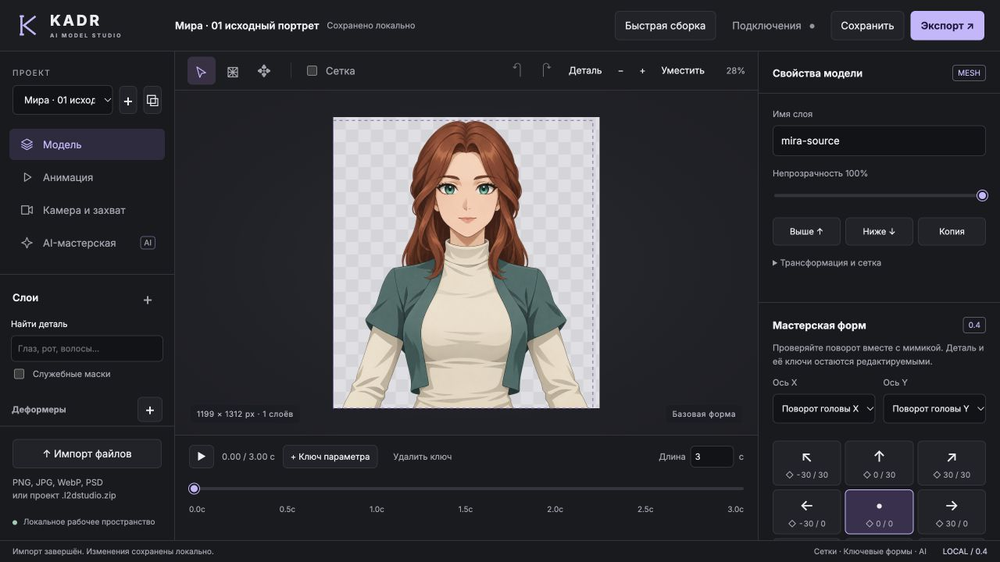

*Помощник создал проект и загрузил исходник через интерфейс. На этом шаге проверяем размер, прозрачность и отсутствие обрезанных деталей.*

### 2. Поручить нейросети восстановить отдельные части

Следующее поручение должно описывать будущую конструкцию: отдельная основа лица, задние волосы, передние пряди, шея, одежда, белки глаз, радужки, веки, брови и рот. Нужны и дополнительные формы — например, закрытые веки и приоткрытый рот.

Пример запроса для одной части: «Оставь только голову с ушами. Удали волосы, глаза, брови и рот, восстанови сплошную кожу и скрытую часть лба. Сохрани масштаб, положение и стиль исходника. Остальное сделай прозрачным». Для одежды отдельно просим дорисовать плечи и воротник, которые закрывали волосы.

| Основа лица | Одежда | Задние волосы |
|---|---|---|
| 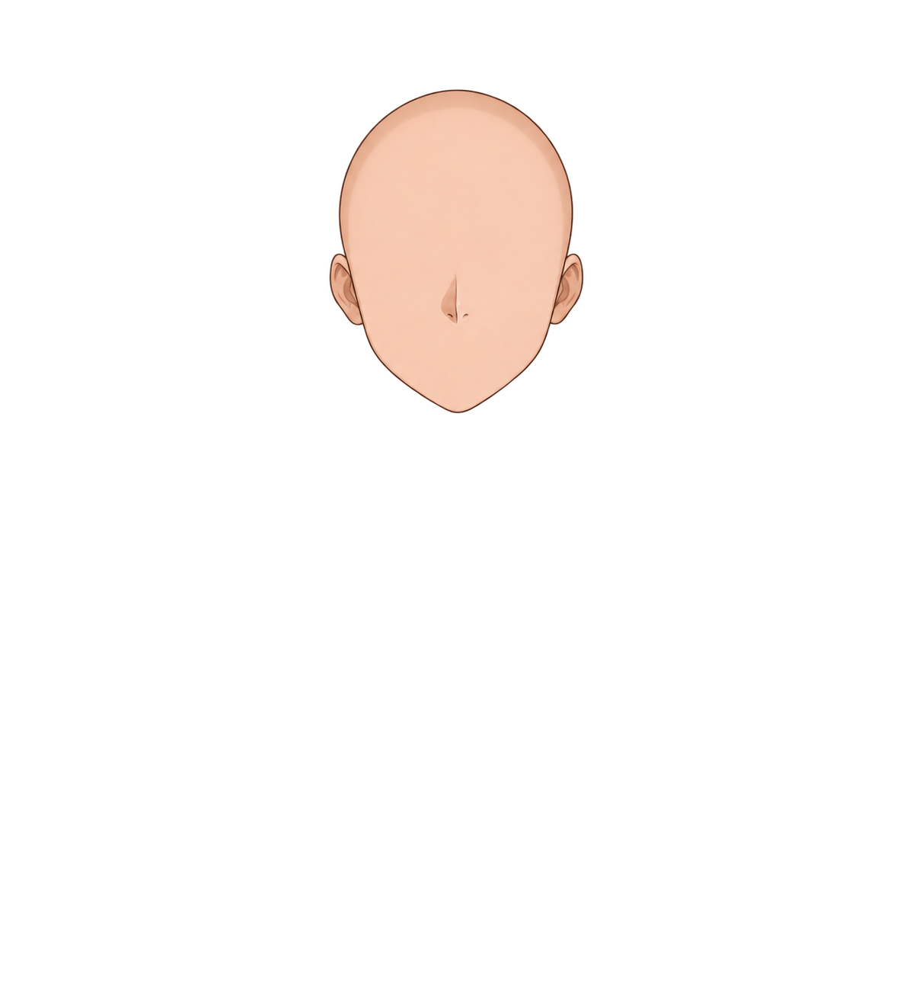 | 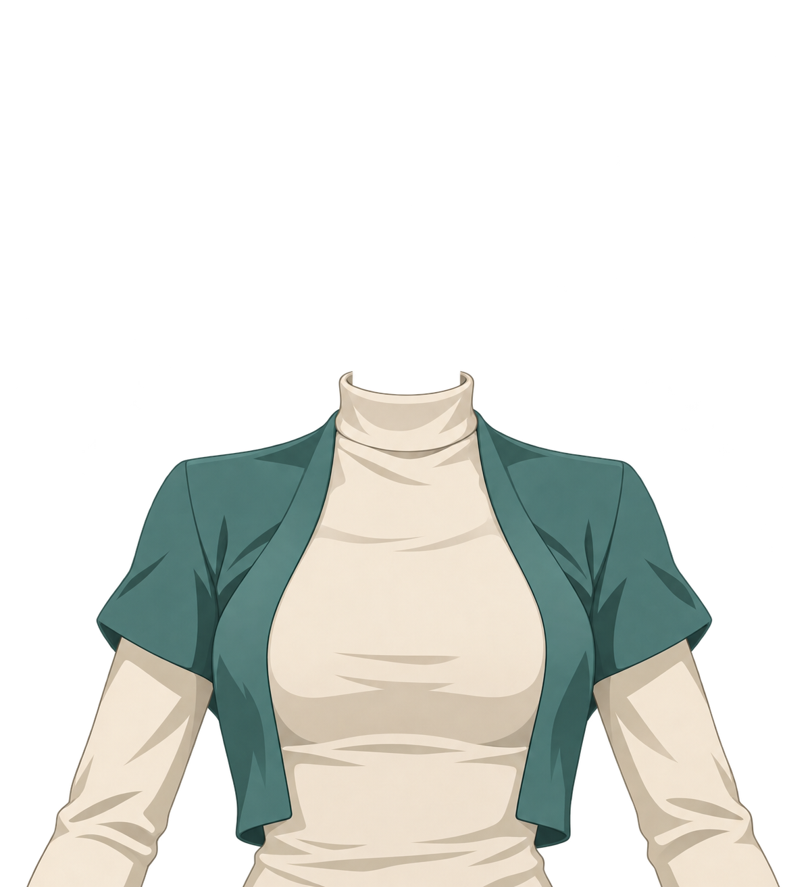 | 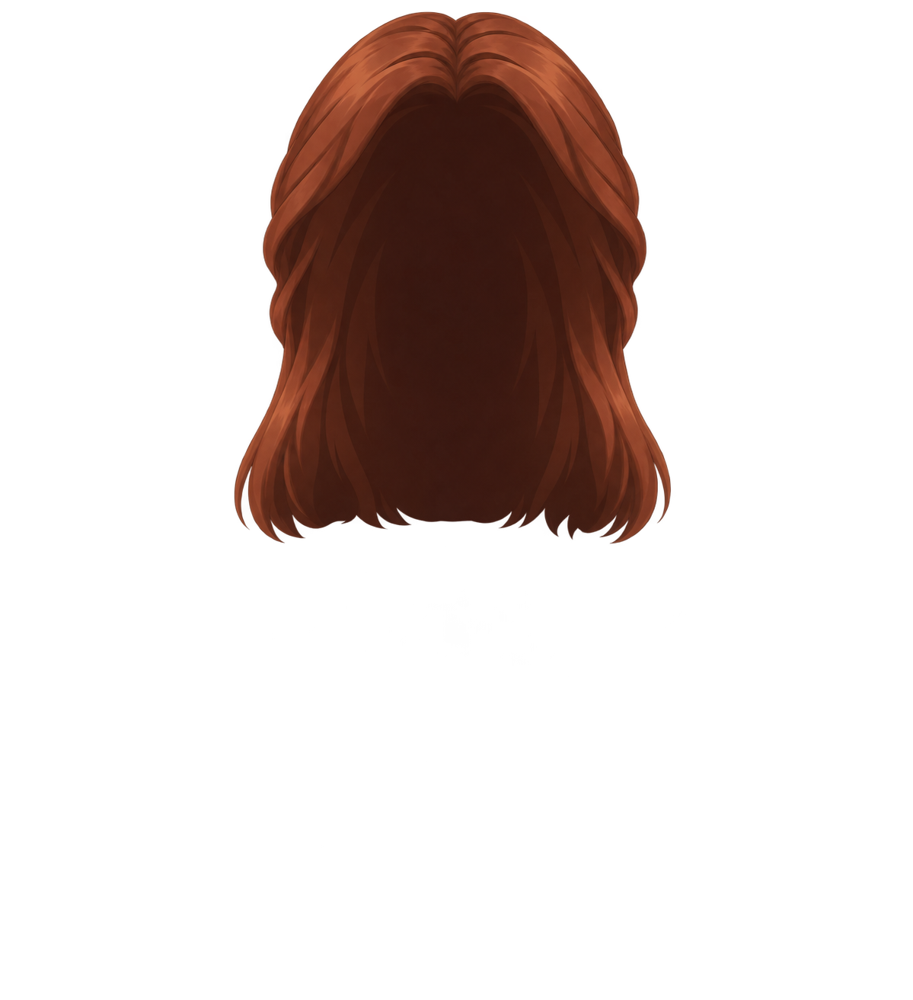 |

*Это результаты генеративного восстановления. Кожа под волосами и одежда под прядями были дорисованы нейросетью.*

В эксперименте выполнено 13 запросов на реконструкцию после генерации исходника. Из результатов подготовлены 18 деталей: парные элементы глаз разделены по сторонам, слабые остатки прозрачности очищены, положение и масштаб уточнены. Эти технические операции выполняются скриптом. Сами новые рисунки и скрытые области получены нейросетью.

### 3. Импортировать слои и проверить совмещение

Подготовленные детали можно собрать в PSD и импортировать одним файлом. Помощник открывает такой файл, выбирает основу лица и приближает её. Теперь каждый элемент доступен отдельно. В этой демонстрационной поставке 20 слоёв: 18 художественных деталей и две служебные маски.

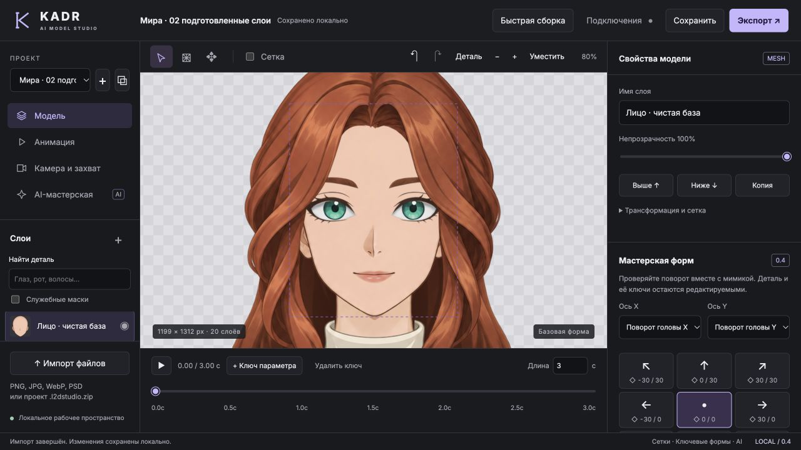

*На холсте выглядит как цельный рисунок, но в списке уже отдельные детали. Справа видно имя выбранного слоя — «Лицо · чистая база».*

Размер общего холста сам по себе не гарантирует совмещение. Помощник сравнивает положение век, радужек и уголков рта. Например, открытый рот в полученной генерации потребовал отдельного выравнивания и изменения размера. Такие поправки сохраняются, чтобы сборку можно было повторить.

### 4. Скрыть пряди и проверить, что находится под ними

Помощник временно выключает две передние пряди. Теперь видны восстановленные лоб, виски и уши. Если оставить под волосами пустоту, при первом движении пряди появится прозрачная щель.

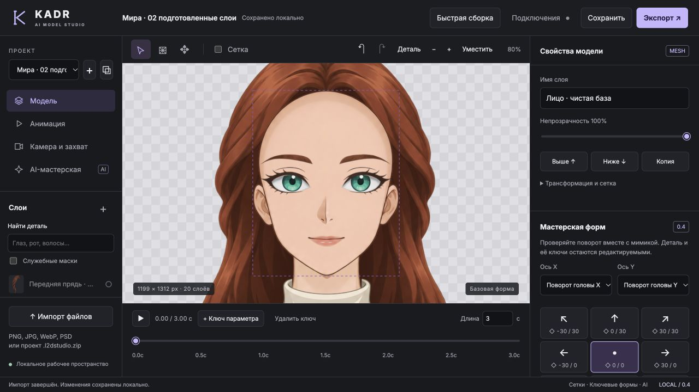

*Рисунок под прядями существует отдельно. После проверки помощник возвращает видимость волос.*

Это удобный способ проверять нейросетевые детали в контексте модели: включать и выключать слои, увеличивать проблемное место и возвращаться к генерации только той части, которая требует исправления.

### 5. Назначить детали в мастере глаз

Дальше помощник открывает «Быструю сборку». Для каждого глаза назначает четыре элемента: белок, радужку, открытое веко и закрытую форму. Стороны считаются от лица персонажа: её левый глаз находится справа для зрителя.

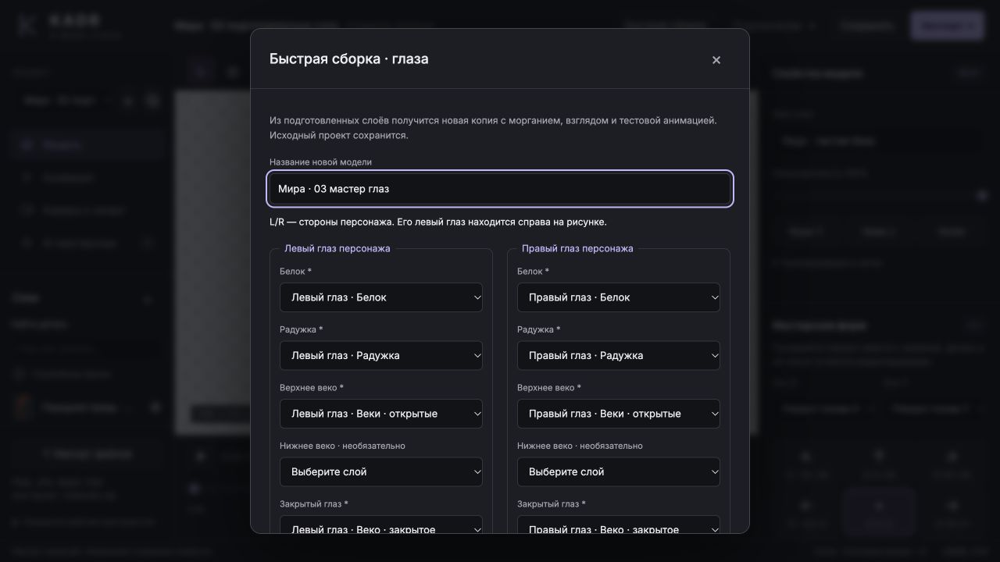

*Названия слоёв позволяют заполнить восемь назначений последовательно. Нижнее веко в этом примере не назначено отдельным слоем.*

После назначения помощник нажимает «Проверить схему». Редактор подтверждает, что модель можно собирать, и напоминает проверить промежуточное закрытие века.

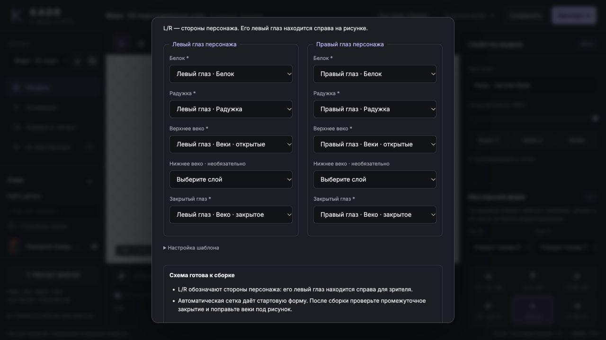

*Схема готова к сборке. Проверка структуры помогает поймать пропущенную деталь до создания новой модели.*

Мастер создаёт отдельную копию с параметрами моргания и взгляда, масками и тестовой анимацией. Назначенные изображения остаются доступными для дальнейшей правки.

### 6. Проверить каждый глаз отдельно и на половине закрытия

Помощник ставит открытие левого глаза в ноль, оставляя правый открытым. На скриншоте видны и результат, и значения параметров. Так проверяется независимость двух глаз.

*Левый глаз персонажа: 0. Правый: 1. Закрытая форма находится на нужной стороне лица.*

Затем помощник выставляет 0,5. Здесь видно, как ведут себя контур века, белок и радужка между крайними формами.

*Половина диапазона показывает качество перехода. Стартовый шаблон требует визуальной оценки и при необходимости уточнения контура.*

В полной модели Миры помощник дополнительно уточнил линию закрытия и отделил маску от видимого белка. При демонстрации готового движения стоит смотреть и короткие промежуточные кадры: красивый открытый и закрытый глаз ещё не гарантируют аккуратное моргание.

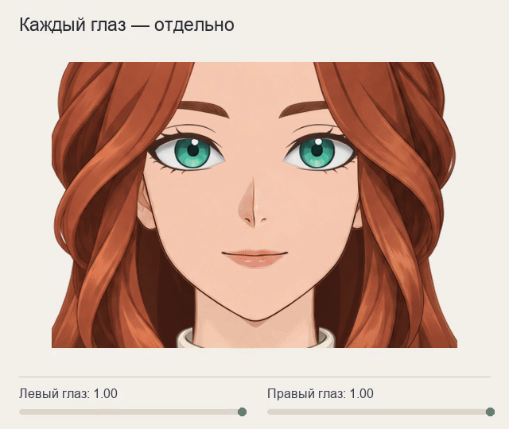

*Анимационный пример: по очереди закрываются левый и правый глаз, затем оба. Стороны указаны от лица персонажа. Значения под рисунком показывают степень открытия; остальные параметры зафиксированы.*

[Открыть видео с управлением воспроизведением](media/mira-blink-example.mp4)

### 7. Проверить маску радужки

Помощник выбирает радужку и раскрывает «Маски и обрезка». В результате мастера радужка обрезается по белку своего глаза. Это удерживает её внутри видимой области при движении взгляда.

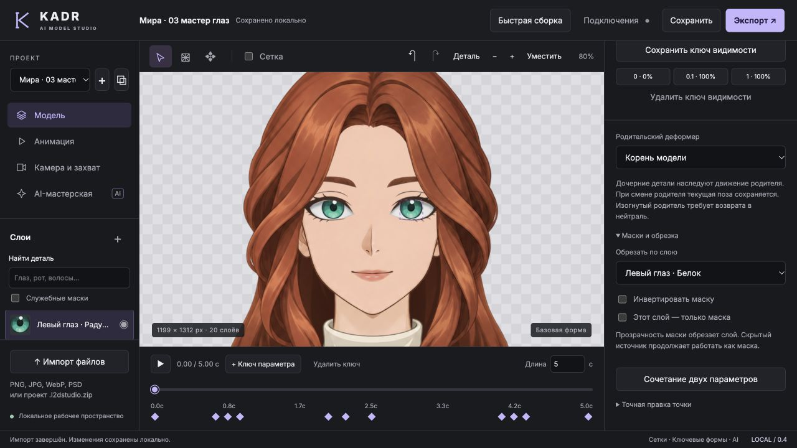

*Справа показано назначение «Левый глаз · Белок». Прозрачность источника определяет, какую часть радужки видно.*

В уточнённой модели используются отдельные служебные маски с формой закрывающегося глаза. Проверка остаётся той же: сдвинуть взгляд и закрыть веки в нескольких положениях, убедиться, что радужка не выходит за край и не исчезает раньше времени.

### 8. Осмотреть сетки и связать общие движения

Рисунок деформируется через вершины сетки. Помощник может выбрать слой, открыть его геометрию, записать ключевые формы и привязать деталь к общему деформеру. На скриншоте видна сетка основы лица; глаза и рот находятся на собственных слоях поверх неё.

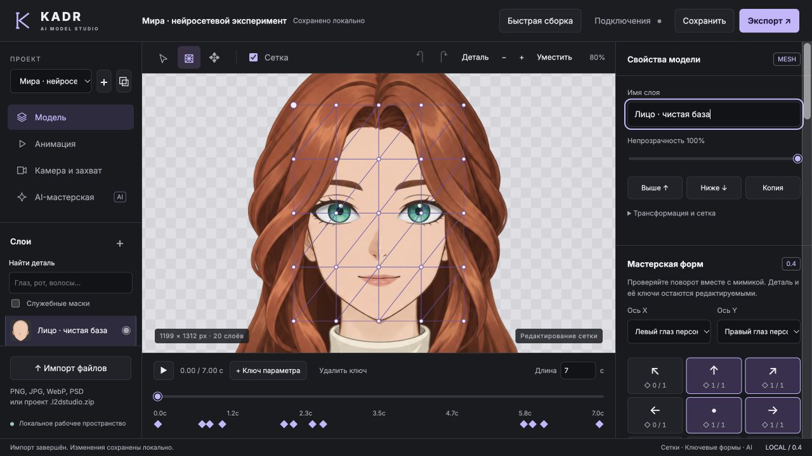

*Сетка остаётся редактируемой. Для общего наклона детали головы привязаны к вращательному деформеру, поэтому движутся согласованно.*

В Мире подготовлены девять параметров: независимое открытие глаз, взгляд по двум осям, рот, наклон головы, движение прядей, дыхание и брови. Для прядей смещение усиливается к концам, а корни остаются почти неподвижными. Дыхание слегка поднимает верх одежды. Так помощник задаёт небольшой понятный набор движений, который можно поправить вручную.

### 9. Проверить движения в сочетании

Сначала помощник меняет взгляд при открытых глазах. Затем проверяет рот одновременно с наклоном головы. Такая последовательность помогает заметить расхождение деталей, которое не проявлялось в нейтральной позе.

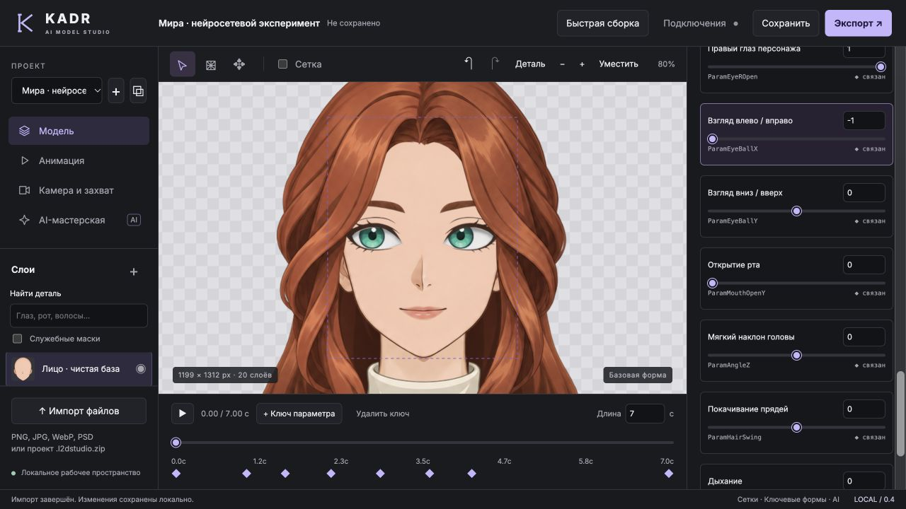

*Ползунок взгляда выставлен в край диапазона. Радужки остаются внутри глаз.*

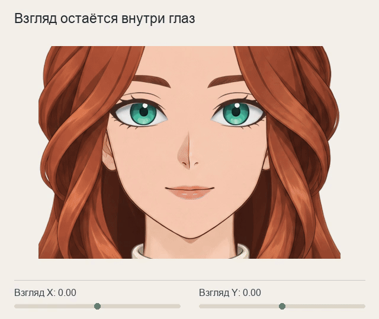

*Анимационный пример: взгляд проходит по горизонтали и вертикали при открытых глазах. Радужки остаются внутри белков. Меняются только параметры взгляда; числовые значения помогают повторить проверку.*

[Открыть видео с управлением воспроизведением](media/mira-gaze-example.mp4)

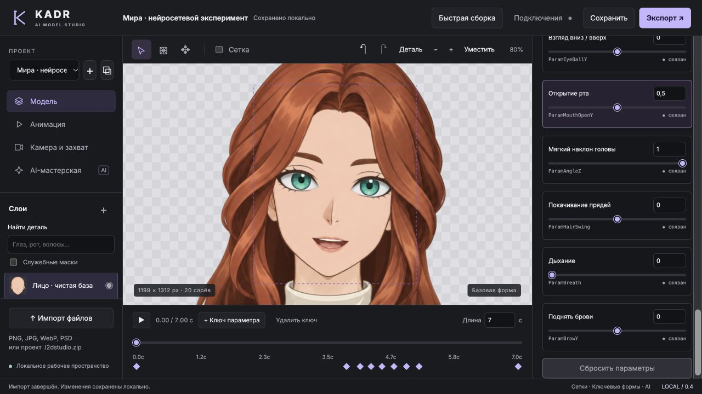

*Открытие рта — 0,5, наклон — 1. Это проверочная поза: в спокойной демонстрации амплитуды значительно меньше.*

У текущего примера голова наклоняется в плоскости рисунка. Объёмный разворот лица не создан. Рот использует две художественные формы и промежуточное изменение геометрии; синхронизации с фонемами речи в этом примере нет.

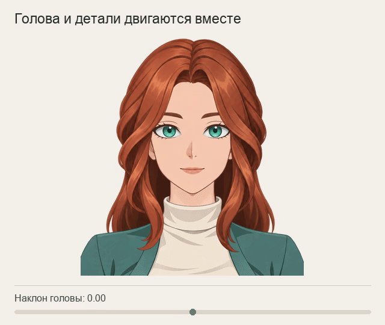

*Анимационный пример: меняется только наклон головы. Глаза, рот и волосы следуют за общим деформером. Это поворот в плоскости рисунка; объёмный разворот здесь не показывается.*

[Открыть видео с управлением воспроизведением](media/mira-tilt-example.mp4)

### 10. Собрать спокойную анимацию

Для показа помощник создаёт отдельную девятисекундную копию. В ней — лёгкое дыхание, три естественных моргания, небольшие переводы взгляда, мягкий наклон и короткое приоткрытие рта. Пряди следуют за движением с небольшим запаздыванием. Исходные рисунки и геометрия модели сохраняются.

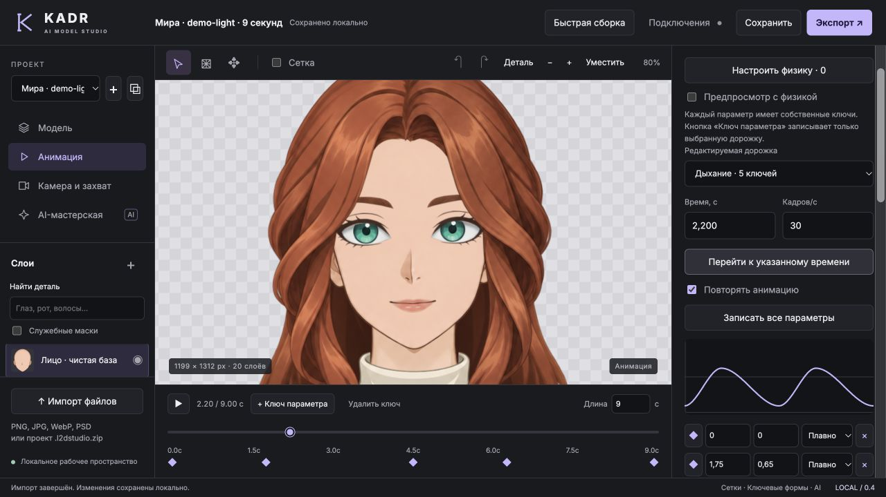

*На шкале времени выбирается конкретный момент, справа — дорожка и её ключи. Дыхание распределено на всю петлю.*

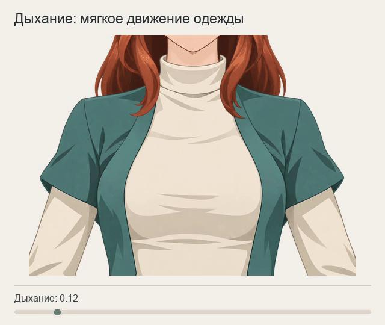

*Анимационный пример: параметр дыхания плавно меняется от 0,12 до 0,85 и обратно. На увеличении видно небольшое движение одежды. Голова, глаза и рот остаются неподвижными.*

[Открыть видео с управлением воспроизведением](media/mira-breath-example.mp4)

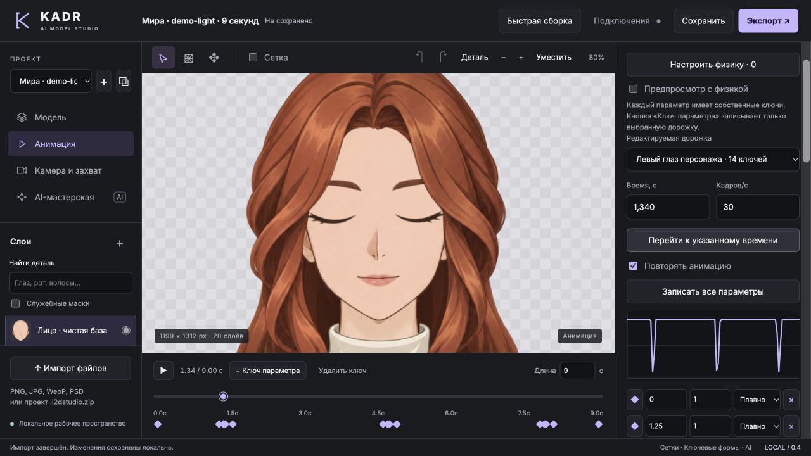

*На отметке 1,34 секунды глаза закрыты. Кривая показывает короткое закрытие и возвращение в открытое состояние.*

Запаздывание волос рассчитано пружиной Лицедей и записано в обычные редактируемые ключи. Поэтому в готовой копии для его воспроизведения не требуется включать отдельную физическую группу.

При проверке петли обнаружилась небольшая растровая дрожь на точно нулевом дыхании. Помощник немного поднял нижнее значение и повторил рендер. На скриншотах дорожек показана рабочая итерация до этой небольшой корректировки. Это пример цикла «настроить → посмотреть → исправить конкретный участок».

### 11. Экспортировать проект и открыть его обратно

Помощник выбирает экспорт полного проекта. Редактор показывает подтверждение «Файл готов» и ссылку на ZIP. В архив переходят изображения, сетки, параметры и анимация.

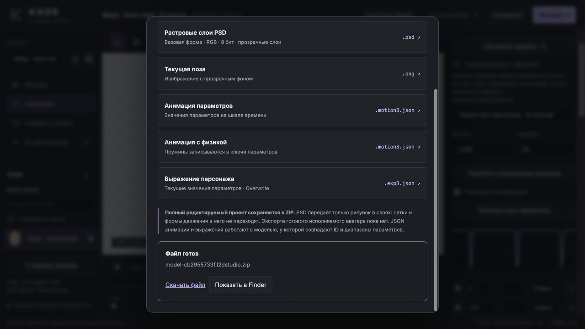

*Для продолжения работы нужен полный ZIP-проект. PNG сохраняет одну позу, а PSD передаёт растровые слои без рига.*

Следом помощник импортирует полученный архив и переходит к выбранному времени. Дорожка наклона и модель доступны после повторного открытия.

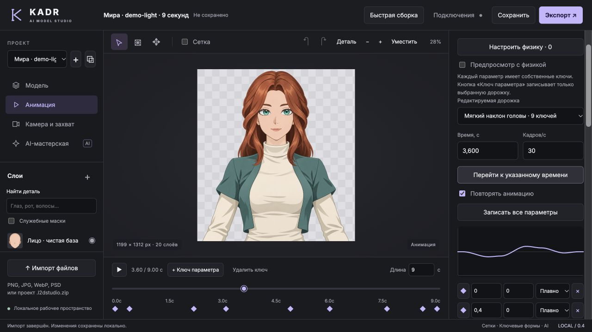

*Проверка завершает рабочий маршрут: результат можно переносить и продолжать редактировать.*

### 12. Посмотреть итоговое движение

[Открыть девятисекундное видео](media/mira-demo-light.mp4) · [Скачать редактируемый проект](examples/Mira-demo-light.l2dstudio.zip)

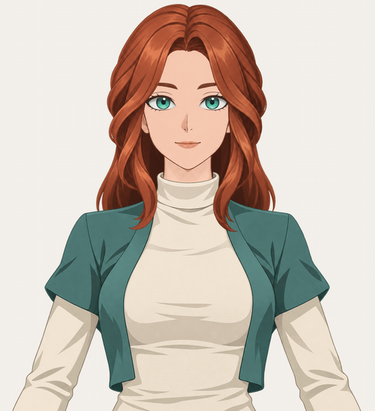

*Это рендер реальной модели: 9 секунд, 30 кадров в секунду, без звука. GIF служит компактным предпросмотром; плавность лучше оценивать по MP4.*

После повторного импорта итогового проекта совпали пиксели в 12 проверочных позах; начало и конец петли совпадают. Проверены независимость моргания и маски при нескольких степенях закрытия. В коротком переходе между открытым и закрытым веком заметно небольшое осветление контура — это оставшаяся особенность демонстрационного рига.

### Что именно ускоряет AI-помощник

| Работа | Что берёт на себя помощник | Что получает автор |
|---|---|---|
| Подготовка рисунка | Формулирует запросы для отдельных частей и скрытых участков | Набор изображений, пригодных для сборки |
| Подготовка файлов | Разделяет парные элементы, проверяет прозрачность, совмещает части | Повторяемую структуру слоёв |
| Работа в приложении | Импортирует, выбирает слои, заполняет назначения, проверяет схему | Модель с настроенной основой глаз |
| Настройка движения | Задаёт параметры, деформеры, формы и дорожки | Редактируемое движение |
| Проверка | Меняет позы, изучает промежуточные кадры, повторяет экспорт и импорт | Конкретные найденные ошибки и проверенный файл |

Помощник работает двумя способами: управляет видимым интерфейсом и выполняет пакетные операции через программные функции Лицедей. В этом разборе импорт, назначения в мастере, проверки ползунков и экспорт выполнены через интерфейс. Повторяемая сборка полной модели и расчёт кадров используют функции редактора. Нейросеть, создающая изображения, отвечает за художественные детали; решение о следующем действии принимает AI-помощник с доступом к этим инструментам.

Автор может дать поручение: «Подготовь из этого портрета модель, проверь каждый глаз отдельно, добавь спокойное дыхание и покажи скриншоты промежуточных шагов». Помощник разбивает его на операции и возвращается к проблемной детали после проверки. Человеку остаются выбор образа, желаемой выразительности и оценка результата; он может вмешаться на любом этапе.

Экономия возникает за счёт серии выполненных действий: не приходится вручную повторять назначения, подготовку файлов и одинаковые проверки для каждой части. Время ручной работы для сравнения в этом эксперименте не измерялось, поэтому обещать конкретное ускорение или гарантированный аватар за день по нему нельзя. Уже показан воспроизводимый путь к простому редактируемому персонажу с лёгкой анимацией.

## Что сохраняется и что можно экспортировать

Проекты хранятся локально и автоматически сохраняются при работе. Можно создать самостоятельную копию для эксперимента. Если другая версия проекта уже была сохранена, редактор обнаруживает конфликт и предлагает сохранить свою работу отдельно.

Для переноса используется собственный ZIP-проект Лицедей. В нём находятся изображения, геометрия, параметры, ключевые формы, деформеры и анимация. Такой архив можно открыть обратно в редакторе.

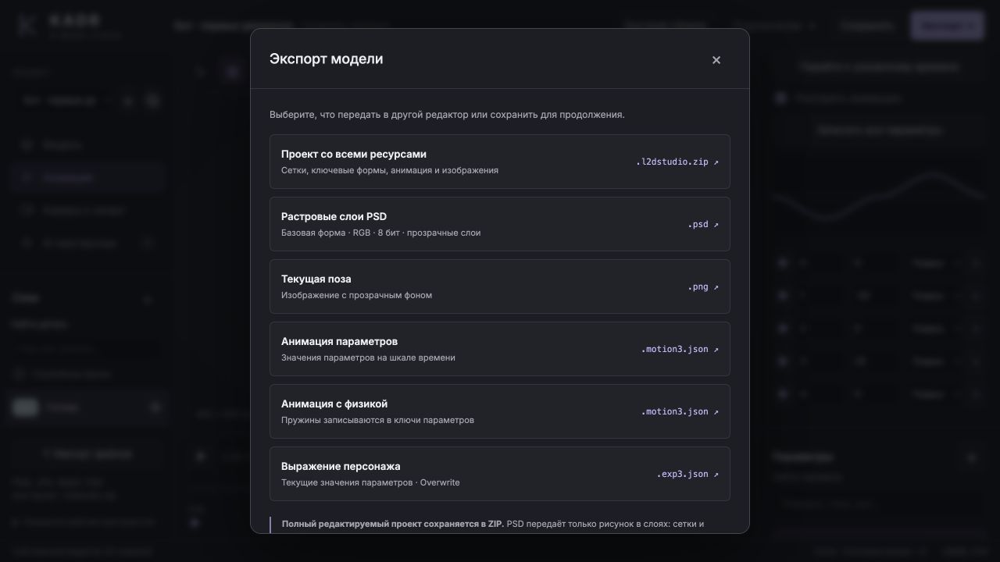

*Полный проект переносит рисунок и настройки движения. PSD и PNG решают другие задачи, поэтому перед экспортом важно выбрать нужный результат.*

Есть и отдельные форматы результата:

- PNG — текущая поза на прозрачном фоне.
- PSD — растровые слои в базовой позе; сетки и формы движения в него не переходят.
- JSON-анимация — дорожки параметров, в том числе вариант с рассчитанной физикой.
- JSON-выражение — текущие значения параметров.

JSON с движением или выражением требует подходящей модели с совпадающими идентификаторами и диапазонами параметров. Сам по себе он не содержит рисунок и геометрию персонажа. Универсального экспорта готового исполняемого аватара сейчас нет.

## Первый маленький эксперимент

Для знакомства достаточно собрать одно простое движение:

1. Подготовить несколько отдельных деталей персонажа и импортировать их.
2. Проверить порядок слоёв, видимость и расположение на холсте.
3. Выбрать одну деталь, добавить параметр и задать две опорные формы.
4. Подвигать ползунок и поправить промежуточный результат.
5. Поставить несколько ключей на шкале времени и воспроизвести анимацию.
6. Сохранить ZIP-проект и открыть его повторно.

Так можно пройти весь базовый маршрут и понять связь рисунка, сетки, параметра и анимации до перехода к сложной модели.

## Что показала проверка прототипа

На модели из 85 слоёв проверены поворот головы, независимое моргание, перемещение вершины, отмена правки, воспроизведение и восстановление проекта после перезагрузки.

Отдельно проверили переносимый архив. После обратного импорта совпали геометрия, ключи и пиксели всех 55 уникальных изображений. В проекте сохранились 39 параметров, 53 деформера и 9 дорожек. В этой проверке прошли 55 автоматических тестов. После подготовки очищенной поставки отдельно прошли все 59 тестов её набора.

Этот результат подтверждает рабочую основу редактора. Камера и платная генерация через подключённые внутри редактора сервисы в этой проверке не испытывались. Портрет Миры получен отдельным нейросетевым инструментом; это не проверка встроенного облачного подключения Лицедей.

## Куда развивается Лицедей

Ближайшая задача — сделать рабочее пространство удобнее. Сейчас панели занимают слишком много места, а до нужных параметров приходится прокручивать длинный список. Для новичка следующий шаг должен быть заметен прямо в интерфейсе.

Дальше нужны более свободное редактирование сеток, универсальные инструменты головы и рта, более сложные демонстрационные модели, запись захвата и самостоятельная установка. Текущая сборка для macOS использует папку проекта и подготовленное окружение; готовность отдельного установщика для других компьютеров ещё предстоит проверить.

Открытая публикация исходников должна позволить изучать устройство Лицедей, повторять эксперименты и улучшать программу. Мне интересно, насколько понятным получится сделать путь от подготовленного рисунка до первого живого движения — особенно для человека, который раньше не занимался ригом.
