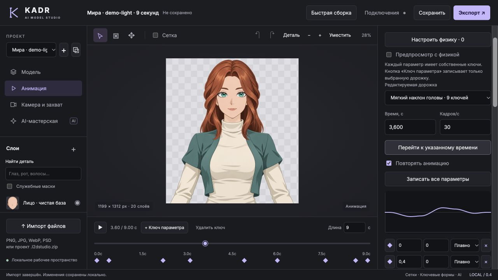
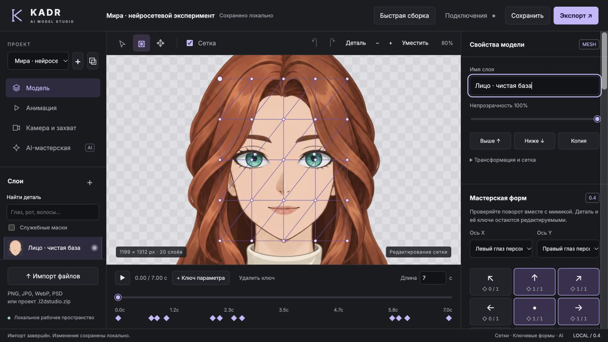
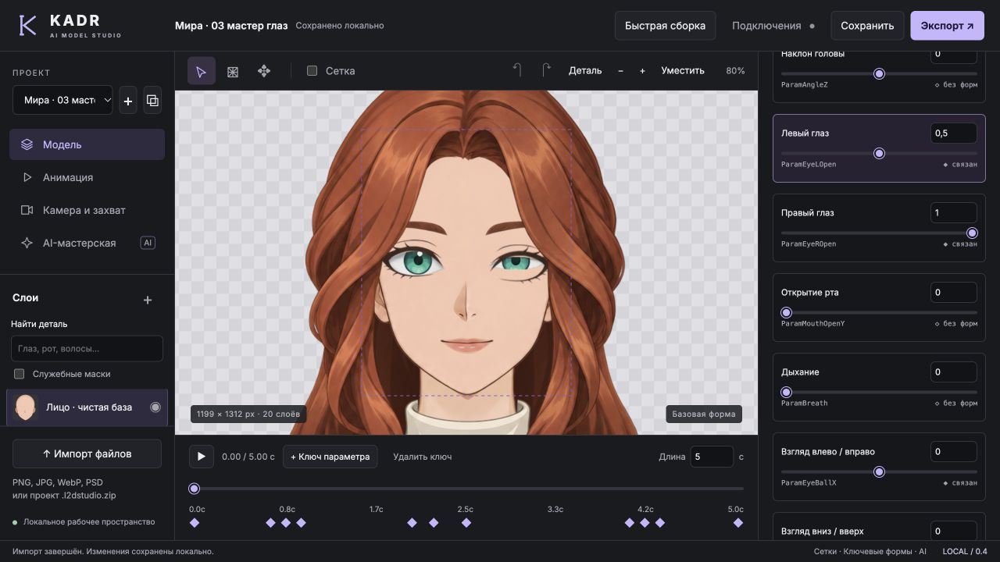
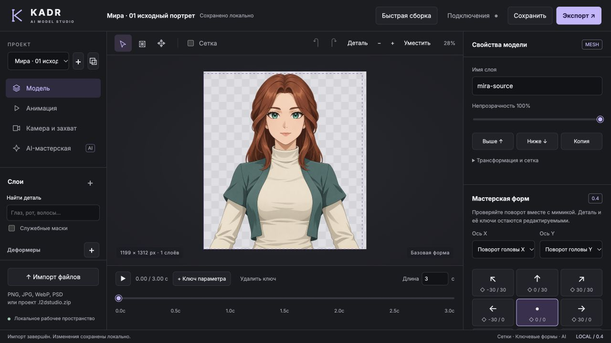
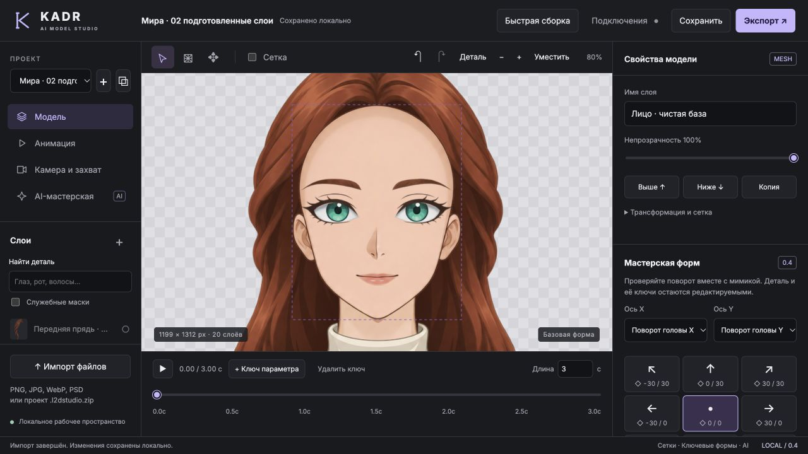
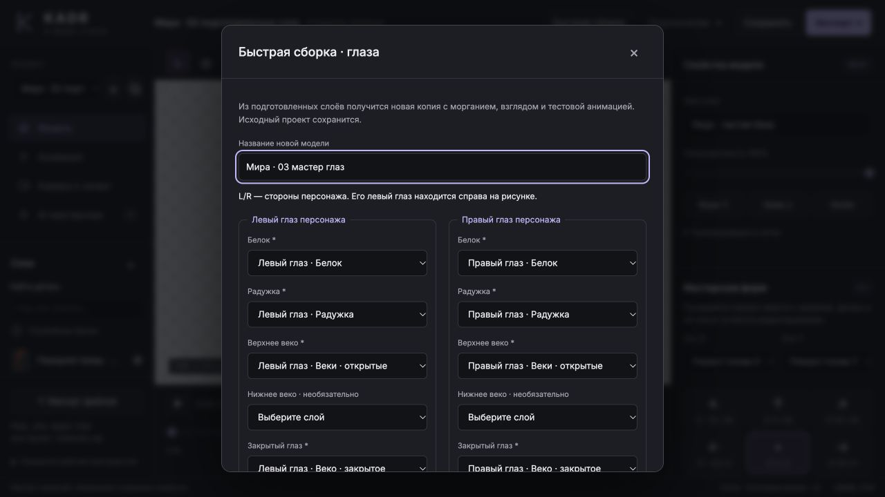
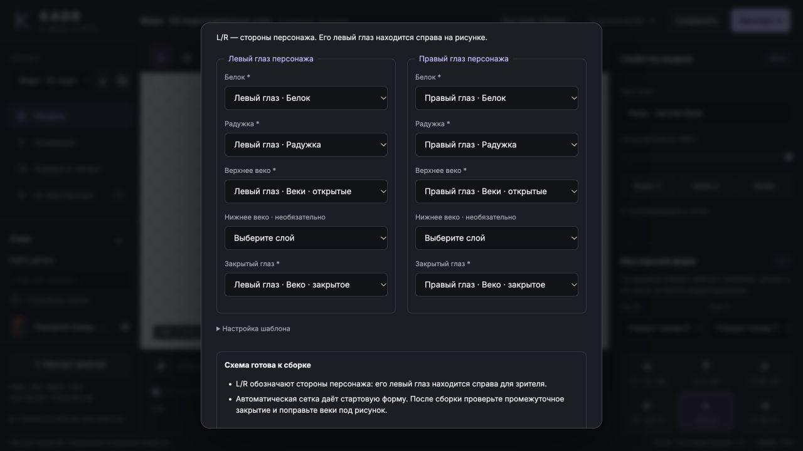
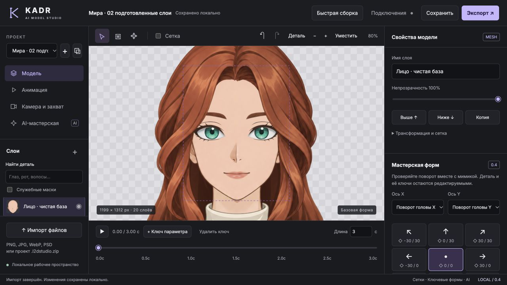
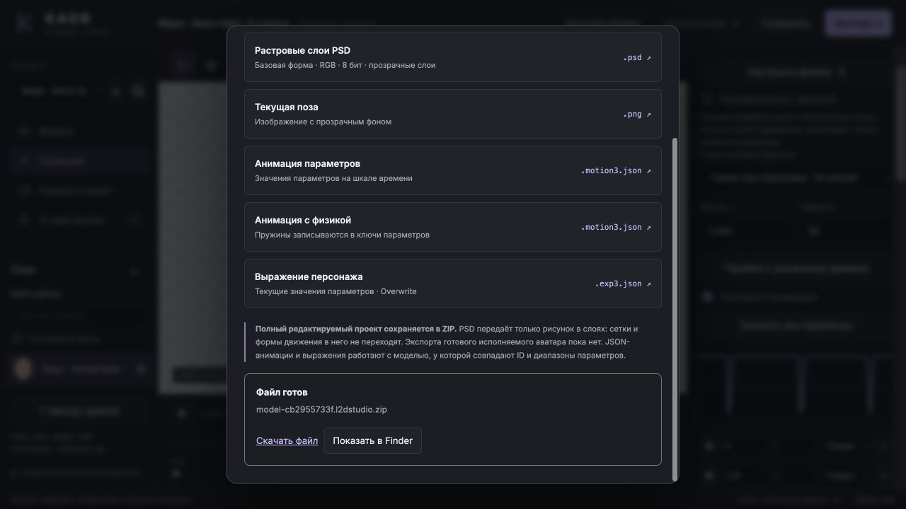

# Лицедей: от первого движения к своему персонажу

Начнём с уже собранной Миры. Посмотрим, как меняются рот, глаза и наклон головы, затем настроим темп и выражение. После этого будет проще собрать собственного персонажа: мы уже знаем, какие детали и формы нужны для результата.

Лицедей 0.4 является рабочим прототипом. Он редактирует слои, сетки, параметры и анимацию, а также содержит локальный предпросмотр лицевого захвата. Самый быстрый путь к первому движению проходит через готовый проект. Своя модель из цельной картинки потребует отдельной подготовки.

## 1. Запустить редактор

Для запуска нужна папка исходников Лицедей 0.4 и Python 3.9–3.12. На macOS откройте терминал в этой папке и выполните:

```sh
python3 -m venv .venv
.venv/bin/python -m pip install -r requirements.txt
.venv/bin/python server.py
```

Затем откройте http://127.0.0.1:18321/ в современном настольном браузере. Пока редактор нужен, оставьте терминал открытым. Для остановки сервера нажмите Ctrl+C. Node.js для обычного запуска не требуется.

После установки зависимостей на macOS можно использовать Start.command. Локальный Лицедей.app использует папку проекта и подготовленное окружение; это ещё не самостоятельный установщик. Полной проверки Windows и Linux пока нет. Если порт 18321 занят, запустите server.py с аргументом --port 18322 и откройте соответствующий адрес.

В новом рабочем пространстве появляется «Бот · первые движения». Нажмите ▶ под холстом. Бот показывает принцип работы ещё до импорта собственного рисунка.

## 2. Открыть готовую Миру

Скачайте один из проектов и выберите его через «Импорт файлов». ZIP распаковывать не нужно: редактор создаст отдельный проект с рисунками, сетками, формами и дорожками.

- [Рот: открытие и ритм реплики](examples/Mira-mouth-example.l2dstudio.zip), 8 секунд.
- [Мимика: сочетание готовых форм](examples/Mira-expressions-example.l2dstudio.zip), 9 секунд.
- [Наклон головы и взгляд](examples/Mira-head-example.l2dstudio.zip), 8 секунд.
- [Общая спокойная анимация](examples/Mira-demo-light.l2dstudio.zip), 9 секунд.



Нажмите ▶, затем остановите воспроизведение и перейдите во вкладку «Модель». Сделайте копию проекта кнопкой рядом с выбором проекта, если хотите сохранить исходный пример для сравнения.

В списке параметров найдите «Открытие рта», «Мягкий наклон головы» и «Поднять брови». Меняйте числовое значение или ползунок. Для проверки можно отключить режим «Редактировать ключевую форму»: простое движение ползунка не должно случайно превратиться в правку геометрии.

В каждом видео ниже используются существующие формы Миры. Кадры рассчитаны ядром Лицедей, подписи добавлены отдельно. Ролики не являются записью интерфейса или камеры; встроенного экспорта видео в версии 0.4 нет.

## 3. Настроить открытие рта

У Миры два рисунка рта: закрытый и открытый. Параметр «Открытие рта» меняет их видимость и геометрию открытой формы.

[Посмотреть открытие рта](media/mira-mouth-example.mp4)

Проверьте три значения: 0, 0,5 и 1. На нуле рот закрыт, на единице открыт полностью. Промежуточное значение показывает качество перехода. Если на нём появляется двойной контур, нужно поправить совмещение рисунков или ключи видимости, а не добавлять новые движения поверх ошибки.

Чтобы изменить ритм примера, откройте «Анимация» и выберите дорожку «Открытие рта». У ключей доступны время, значение и переход после ключа: «Линейно», «Плавно» или «Ступень». Уменьшите значения пиков, если персонаж открывает рот слишком широко. Раздвиньте ключи для более медленного движения или добавьте участок с нулём для паузы.

Для своего короткого цикла установите длительность 2 секунды и запишите значения рта: 0 в начале, 0,7 на 0,5 секунды, 0 на 1 секунде, 0,4 на 1,5 секунды и снова 0 на 2 секунде. В каждом положении нажмите «+ Ключ параметра». Для мягкого движения выберите «Плавно» и включите «Повторять анимацию».

Ключевая форма определяет, как выглядит рот при конкретном значении. Ключ на шкале времени определяет, когда это значение появится. Сначала настройте форму, потом её ритм.

В ролике после медленного открытия идёт условный ритм реплики. Звука и разбора фонем здесь нет. В Лицедей отсутствует микрофонное управление ртом; доступный лицевой захват получает открытие челюсти с камеры.

## 4. Собрать выражение лица

Выражение получается из сочетания нескольких движений. В Мире уже можно менять высоту бровей, открытие рта и оба века. Это ограниченный набор форм; он не заменяет отдельные рисунки улыбки, злости или других выражений.

[Посмотреть смену мимики](media/mira-expressions-example.mp4)

Повторите три состояния через параметры:

1. Нейтральное: брови 0, рот 0, оба глаза 1.
2. Приподнятые брови и открытый рот: брови 0,8, рот 0,6, оба глаза 1.
3. Более прикрытые веки: брови −0,25, рот 0, оба глаза 0,65.

Названия эмоций зависят от рисунка. Сначала посмотрите, какое впечатление даёт сочетание именно у вашего персонажа. Если нужна широкая улыбка с другой линией губ, подготовьте для неё рисунок или новые формы: увеличение открытия рта само по себе улыбку не создаёт.

Для последовательности на шкале времени удобно нажать «Записать все параметры» в каждой опорной позе. Это запишет и остальные значения модели, поэтому перед записью верните ненужные движения в нейтраль. Чтобы сохранить только выбранную дорожку, используйте «+ Ключ параметра».

## 5. Настроить наклоны головы в стороны

Голову лучше наклонять как группу. Тогда глаза, брови, рот и волосы сохраняют взаимное положение. В Мире они связаны с вращательным деформером «Голова · наклон ±5°».

[Посмотреть наклоны головы](media/mira-head-example.mp4)

Поставьте «Мягкий наклон головы» в −0,8, затем в 0 и 0,8. Эти значения соответствуют приблизительно четырём градусам наклона в каждую сторону. Это движение в плоскости рисунка. Параметр с числом 0,8 не означает угол 0,8 градуса: диапазон данного примера нормализован от −1 до 1.

Во вкладке «Анимация» уменьшите крайние значения, чтобы сделать наклон спокойнее. В новом ролике взгляд немного опережает голову; если нужен только наклон, оставьте дорожку взгляда на нуле. Для отдельного движения уже есть [ролик с одним параметром](media/mira-tilt-example.mp4).



На своей модели создайте вращательный деформер через «+» в разделе «Деформеры», выберите детали головы с общим родителем и разместите центр около шеи. Свяжите движение рычага с параметром наклона через «Редактировать ключевую форму». Проверьте промежуточные положения, а не только крайние: рот и глаза должны следовать за головой, шея не должна оставлять щель.

## 6. Добавить моргание, взгляд и дыхание

[Независимое моргание](media/mira-blink-example.mp4)

Открытие каждого глаза меняется отдельно: 1 означает открытый глаз, 0 закрытый. Стороны считаются от персонажа. Его левый глаз находится справа для зрителя. Проверьте один закрытый глаз, другой открытый, затем оба глаза на значении 0,5.



[Движение взгляда](media/mira-gaze-example.mp4)

Радужка смещается по горизонтали и вертикали и обрезается маской глаза. Проверьте взгляд при открытом и прикрытом веке. Радужка не должна выходить за край видимой области.

[Дыхание](media/mira-breath-example.mp4)

В этой модели дыхание немного двигает одежду. Для спокойной петли параметр проходит от 0,12 до 0,85 за две секунды и возвращается ещё за две. После отдельных проверок соедините движения. Если что-то ломается только в сочетании, исправляйте конкретную комбинацию, а не всю модель сразу.

## 7. Собрать собственного персонажа быстрее

### Начать с готового примера

Это самый короткий путь к пониманию редактора. Импортируйте ZIP, измените силу движений и ключи времени. Такой старт позволяет сразу увидеть связь параметров и рисунка. Подстановка другого портрета не переносит на него риг автоматически: новые детали нужно совместить и настроить.

### Импортировать подготовленные слои

Для своего рисунка подготовьте PNG на прозрачном фоне или RGB PSD с обычными растровыми слоями, 8 бит на канал. Разделите то, что будет двигаться независимо: голову, одежду, передние пряди, глаза, брови и рот. Для начала достаточно фронтального ракурса.



Цельная картинка удобна как исходник. Для независимого глаза или рта нужны отдельные детали. Под волосами должна существовать кожа, а под подвижной прядью должны быть дорисованы скрытые участки: иначе движение откроет пустоту.



PSD ускоряет импорт нескольких деталей вместе. Сложные эффекты и маски лучше подготовить заранее; группы при импорте уплощаются. Сначала проверьте порядок слоёв и совмещение, затем начинайте риг.

### Использовать мастер глаз

«Быстрая сборка» в версии 0.4 работает с глазами. Для каждого глаза назначьте белок, радужку, открытое веко и закрытую форму. Нижнее веко можно назначить дополнительно. Редактор предлагает соответствия по именам слоёв, но их нужно проверить.



Нажмите «Проверить схему», исправьте замечания и затем «Собрать новую модель». Мастер создаёт отдельную копию с масками, независимым морганием, взглядом и пятисекундной тестовой анимацией. Исходный проект остаётся отдельно.



После сборки проверьте промежуточное закрытие века. Мастер помогает выполнить повторяющиеся операции, но качество перехода зависит от рисунков и геометрии. Универсального мастера рта, головы и тела пока нет.

### Подключить AI-помощника

В эксперименте с Мирой внешний помощник подготовил художественные детали, восстановил скрытые участки, собрал модель и проверил движения. Для рисунков использовалась нейросеть, а для повторяемых действий помощник работал через интерфейс и программные функции Лицедей.

Пример поручения: «Подготовь из этого фронтального портрета отдельные детали. Дорисуй кожу под волосами, сделай закрытые веки и открытую форму рта. Собери копию модели, проверь глаза отдельно, добавь мягкие наклоны головы и покажи промежуточные результаты».



Это способ работы с внешним помощником, которому доступны нужные инструменты и файлы. В самом Лицедей нет кнопки, которая полностью превращает любой портрет в готового персонажа. Встроенная «AI-мастерская» получает изображения через fal или ComfyUI, затем результат можно добавить как слой. Пресет «Эмоция» формулирует запрос на рисунок; он не создаёт автоматическое управление эмоциями.

Платная облачная генерация требует отдельного аккаунта и оплаты сервиса. ComfyUI требует запущенного сервера и подходящей модели. Для работы с готовой Мирой и её анимацией AI-подключение не нужно. [Подробный разбор подготовки Миры с 15 снимками](mira-process-ru.html) показывает весь существующий процесс.

## 8. Проверить управление через камеру

Камера нужна для живого предпросмотра, когда формы модели уже подготовлены. Во вкладке «Камера и захват» выберите устройство, нажмите «Включить камеру» и разрешите доступ в браузере. Посмотрите прямо, расслабьте лицо и нажмите «Запомнить нейтральную позу».

Начните с одного действия: откройте рот. Посмотрите на соответствующий индикатор в «Сигналы персонажа». Если число меняется, а рисунок стоит на месте, у нужного параметра нет подходящих форм. Если рот реагирует слишком слабо или резко, откройте «Чувствительность» и измените «Открытие рта». «Сглаживание» смягчает движение, но увеличивает запаздывание. Затем проверьте моргание и взгляд.

Важна связь с конкретной моделью. Захват передаёт рот в ParamMouthOpenY, глаза в ParamEyeLOpen и ParamEyeROpen, наклон в ParamAngleZ. Брови камеры используют отдельные ParamBrowLY и ParamBrowRY, а у демонстрационной Миры общий ParamBrowY. Поэтому её брови из этого проекта не начнут повторять лицо автоматически. Для этого нужен отдельный этап настройки модели.

У Миры наклон имеет диапазон −1…1, а сигнал камеры выражен в градусах. Без адаптации параметра он быстро достигает предела. Для знакомства используйте готовую дорожку наклона; не считайте демонстрационный ZIP откалиброванным шаблоном для камеры.

Алгоритм и названия элементов интерфейса проверены по реализации Лицедей 0.4. Съёмка реального лица и качество захвата в этом материале не проверялись. Приведённые ролики показывают анимационные ключи, а не результат камеры. Видео и точки лица обрабатываются локально; захват не записывает выступление в анимацию и не заменяет существующие дорожки.

## 9. Сохранить результат

Откройте «Экспорт» и выберите «Проект со всеми ресурсами». Полученный ZIP содержит рисунки, сетки, формы и анимацию. Импортируйте его обратно и проверьте тот же рот, наклон и моргание. Это простой способ убедиться, что проект переносится целиком.



PNG сохраняет текущую позу. PSD передаёт растровые слои без рига. JSON-анимация содержит дорожки параметров, а JSON-выражение их текущие значения. Эти JSON требуют модели с совпадающими идентификаторами и диапазонами. Они не заменяют полный проект.

Звуковой дорожки, фонемного липсинка, записи камеры и кнопки экспорта MP4 в Лицедей 0.4 пока нет. Видео статьи подготовлены отдельно из кадров редактора. Экспорта готового исполняемого аватара для стрима также нет.

## Проверка перед первым показом

- Каждый глаз закрывается отдельно, радужка остаётся внутри маски.
- Рот выглядит аккуратно на 0, 0,5 и 1.
- При наклоне глаза и рот следуют за головой, под волосами и у шеи нет пустот.
- В сочетании мимики и наклона не появляются разрывы.
- Начало и конец повторяемой анимации совпадают.
- ZIP открывается в отдельном проекте и сохраняет рисунки и движения.

В трёх новых примерах проверены 603 положения сетки, совпадение концов петель и повторный импорт проектов. В 15 контрольных позах геометрия JavaScript и Python совпала, а восстановленные проекты дали те же пиксели. Известная особенность Миры остаётся: при промежуточном закрытии века контур может ненадолго светлеть.

Первый полезный результат здесь небольшой: открыть готовую модель, изменить одно движение, сохранить проект и получить его обратно без потерь. Затем ту же последовательность можно повторить уже на собственном рисунке.
