# Как AI-помощник собирает Миру в Лицедей: процесс в 15 скриншотах

Мы поручили AI-помощнику подготовить нового персонажа, собрать модель и добавить лёгкое движение. Получилась Мира: нейросеть создала исходный портрет и отдельные детали, помощник совместил их, настроил глаза, подготовил параметры и анимацию. Ниже показано, что именно происходит между картинкой и движущейся моделью.

Материал обновлён 9 ноября 2026 года. Все 15 скриншотов процесса сняты с работающего Лицедей 0.4. Для последовательного показа часть операций заново выполнена помощником в отдельной демонстрационной копии. Изображения интерфейса не генерировались. Подготовка Миры — эксперимент с внешним AI-помощником, который управляет инструментами редактора; встроенной кнопки полной автоматической сборки персонажа пока нет.

Четыре коротких примера ниже отрендерены из готовой модели ядром Лицедей. Подписи и индикаторы параметров добавлены для объяснения; это не запись интерфейса и не генерация видео.

## 1. Создать исходник и открыть его в редакторе

Сначала задаём образ: взрослая героиня, вид спереди, спокойное выражение, открытые глаза, простая одежда и прозрачный фон. Для первой модели такой ракурс помогает сохранить симметрию и увидеть, совпадают ли детали после разделения.

Помощник генерирует портрет, создаёт в Лицедей проект размером 1199 × 1312 и импортирует PNG. Внизу экрана пока указан один слой. Это важная отправная точка: вся внешность ещё находится на одной картинке, отдельно закрыть глаз или сдвинуть прядь нельзя.

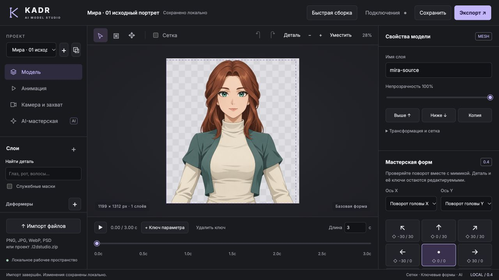

*Помощник создал проект и загрузил исходник через интерфейс. На этом шаге проверяем размер, прозрачность и отсутствие обрезанных деталей.*

## 2. Поручить нейросети восстановить отдельные части

Следующее поручение должно описывать будущую конструкцию: отдельная основа лица, задние волосы, передние пряди, шея, одежда, белки глаз, радужки, веки, брови и рот. Нужны и дополнительные формы — например, закрытые веки и приоткрытый рот.

Пример запроса для одной части: «Оставь только голову с ушами. Удали волосы, глаза, брови и рот, восстанови сплошную кожу и скрытую часть лба. Сохрани масштаб, положение и стиль исходника. Остальное сделай прозрачным». Для одежды отдельно просим дорисовать плечи и воротник, которые закрывали волосы.

| Основа лица | Одежда | Задние волосы |
|---|---|---|
| 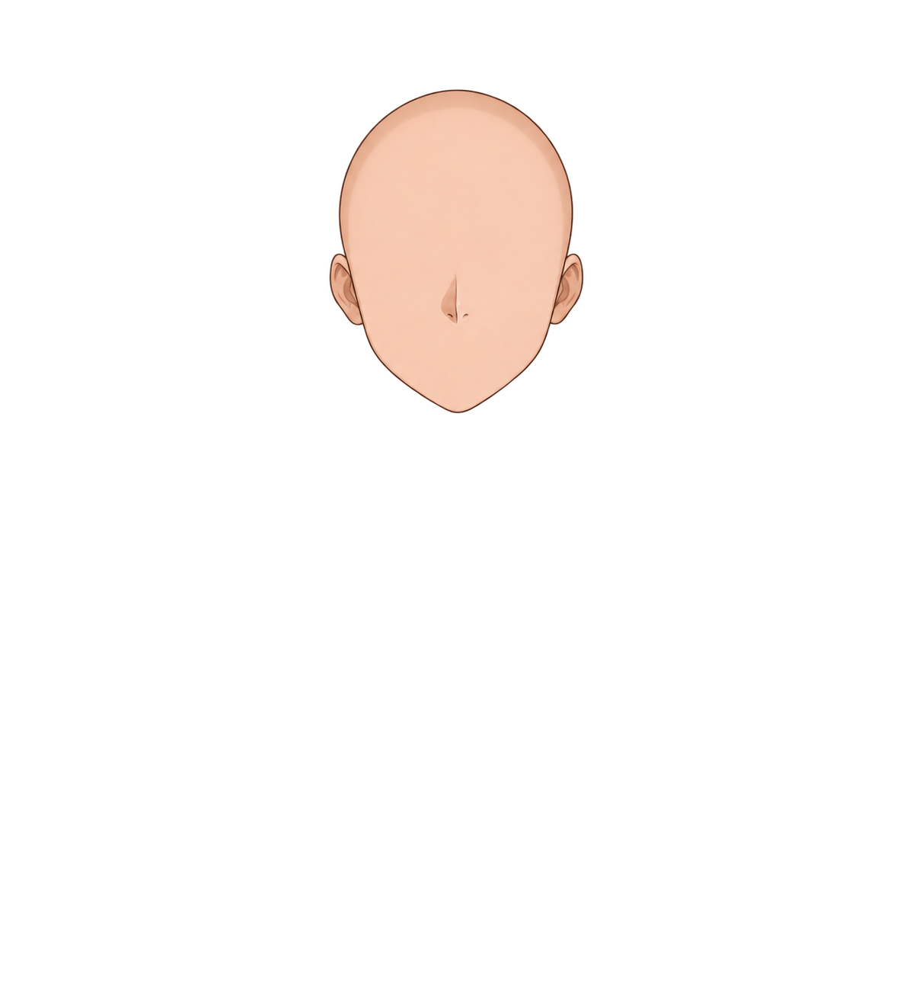 | 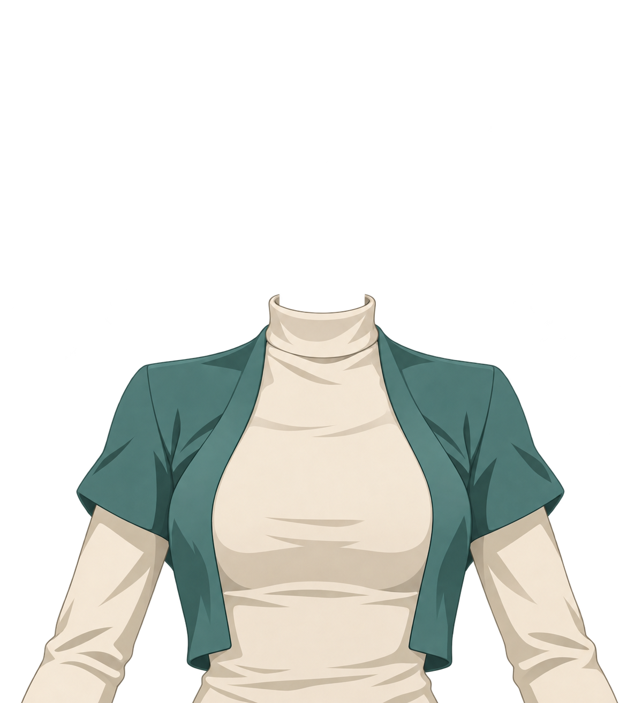 | 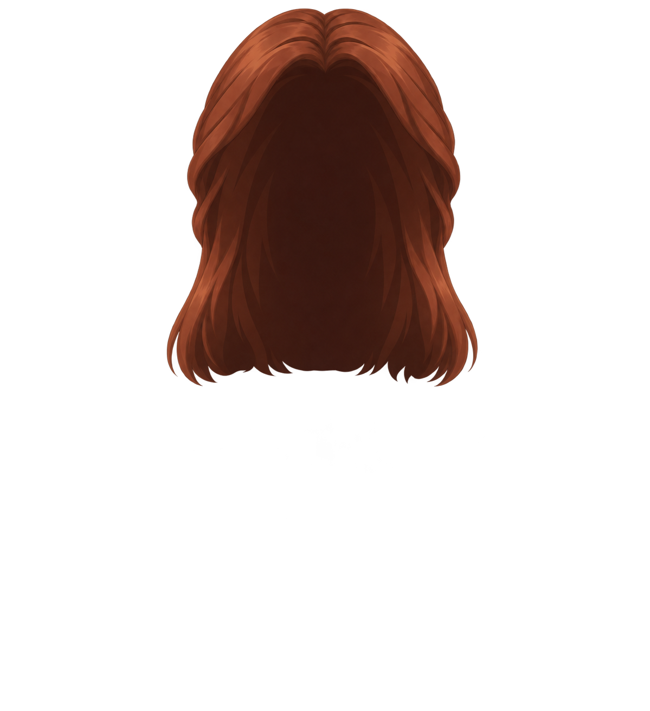 |

*Это результаты генеративного восстановления. Кожа под волосами и одежда под прядями были дорисованы нейросетью.*

В эксперименте выполнено 13 запросов на реконструкцию после генерации исходника. Из результатов подготовлены 18 деталей: парные элементы глаз разделены по сторонам, слабые остатки прозрачности очищены, положение и масштаб уточнены. Эти технические операции выполняются скриптом. Сами новые рисунки и скрытые области получены нейросетью.

## 3. Импортировать слои и проверить совмещение

Подготовленные детали можно собрать в PSD и импортировать одним файлом. Помощник открывает такой файл, выбирает основу лица и приближает её. Теперь каждый элемент доступен отдельно. В этой демонстрационной поставке 20 слоёв: 18 художественных деталей и две служебные маски.

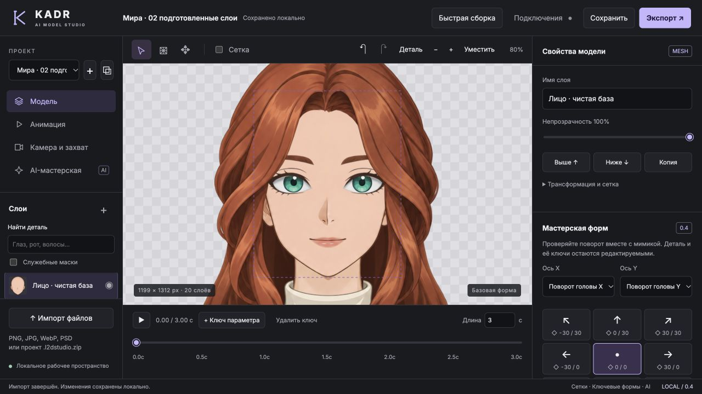

*На холсте выглядит как цельный рисунок, но в списке уже отдельные детали. Справа видно имя выбранного слоя — «Лицо · чистая база».*

Размер общего холста сам по себе не гарантирует совмещение. Помощник сравнивает положение век, радужек и уголков рта. Например, открытый рот в полученной генерации потребовал отдельного выравнивания и изменения размера. Такие поправки сохраняются, чтобы сборку можно было повторить.

## 4. Скрыть пряди и проверить, что находится под ними

Помощник временно выключает две передние пряди. Теперь видны восстановленные лоб, виски и уши. Если оставить под волосами пустоту, при первом движении пряди появится прозрачная щель.

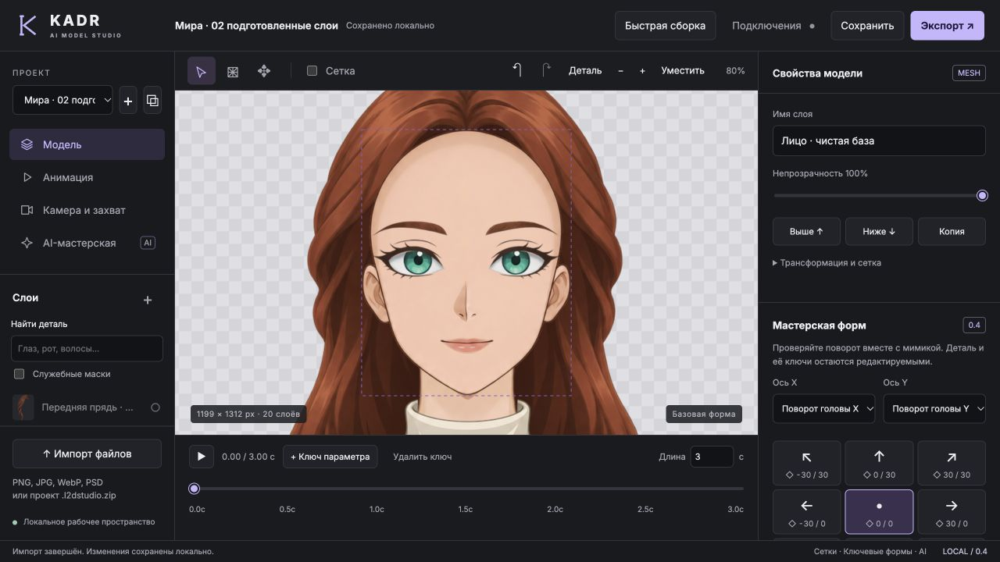

*Рисунок под прядями существует отдельно. После проверки помощник возвращает видимость волос.*

Это удобный способ проверять нейросетевые детали в контексте модели: включать и выключать слои, увеличивать проблемное место и возвращаться к генерации только той части, которая требует исправления.

## 5. Назначить детали в мастере глаз

Дальше помощник открывает «Быструю сборку». Для каждого глаза назначает четыре элемента: белок, радужку, открытое веко и закрытую форму. Стороны считаются от лица персонажа: её левый глаз находится справа для зрителя.

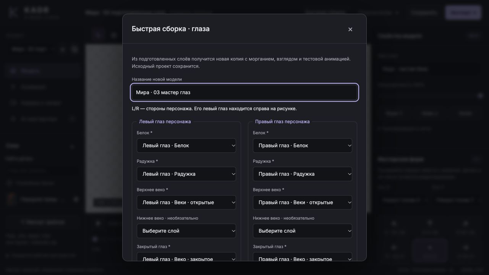

*Названия слоёв позволяют заполнить восемь назначений последовательно. Нижнее веко в этом примере не назначено отдельным слоем.*

После назначения помощник нажимает «Проверить схему». Редактор подтверждает, что модель можно собирать, и напоминает проверить промежуточное закрытие века.

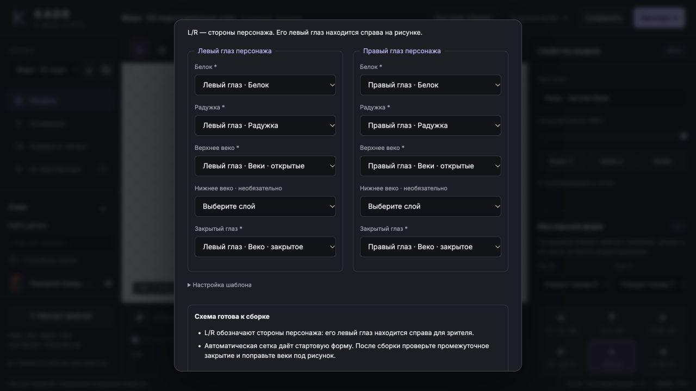

*Схема готова к сборке. Проверка структуры помогает поймать пропущенную деталь до создания новой модели.*

Мастер создаёт отдельную копию с параметрами моргания и взгляда, масками и тестовой анимацией. Назначенные изображения остаются доступными для дальнейшей правки.

## 6. Проверить каждый глаз отдельно и на половине закрытия

Помощник ставит открытие левого глаза в ноль, оставляя правый открытым. На скриншоте видны и результат, и значения параметров. Так проверяется независимость двух глаз.

*Левый глаз персонажа: 0. Правый: 1. Закрытая форма находится на нужной стороне лица.*

Затем помощник выставляет 0,5. Здесь видно, как ведут себя контур века, белок и радужка между крайними формами.

*Половина диапазона показывает качество перехода. Стартовый шаблон требует визуальной оценки и при необходимости уточнения контура.*

В полной модели Миры помощник дополнительно уточнил линию закрытия и отделил маску от видимого белка. При демонстрации готового движения стоит смотреть и короткие промежуточные кадры: красивый открытый и закрытый глаз ещё не гарантируют аккуратное моргание.

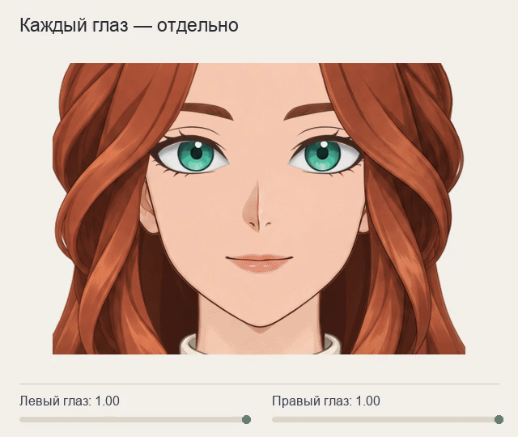

*Анимационный пример: по очереди закрываются левый и правый глаз, затем оба. Стороны указаны от лица персонажа. Значения под рисунком показывают степень открытия; остальные параметры зафиксированы.*

[Открыть видео с управлением воспроизведением](media/mira-blink-example.mp4)

## 7. Проверить маску радужки

Помощник выбирает радужку и раскрывает «Маски и обрезка». В результате мастера радужка обрезается по белку своего глаза. Это удерживает её внутри видимой области при движении взгляда.

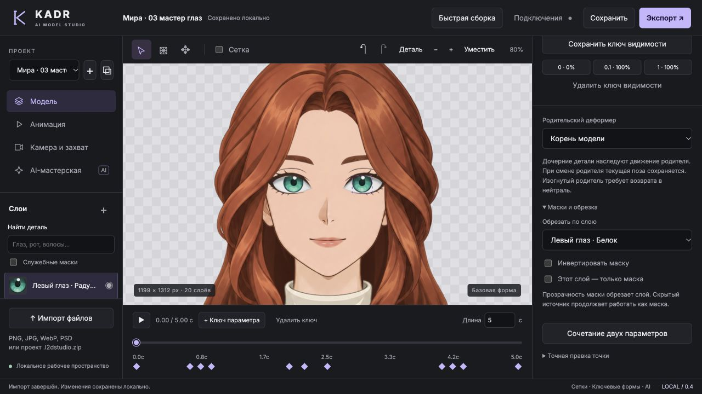

*Справа показано назначение «Левый глаз · Белок». Прозрачность источника определяет, какую часть радужки видно.*

В уточнённой модели используются отдельные служебные маски с формой закрывающегося глаза. Проверка остаётся той же: сдвинуть взгляд и закрыть веки в нескольких положениях, убедиться, что радужка не выходит за край и не исчезает раньше времени.

## 8. Осмотреть сетки и связать общие движения

Рисунок деформируется через вершины сетки. Помощник может выбрать слой, открыть его геометрию, записать ключевые формы и привязать деталь к общему деформеру. На скриншоте видна сетка основы лица; глаза и рот находятся на собственных слоях поверх неё.

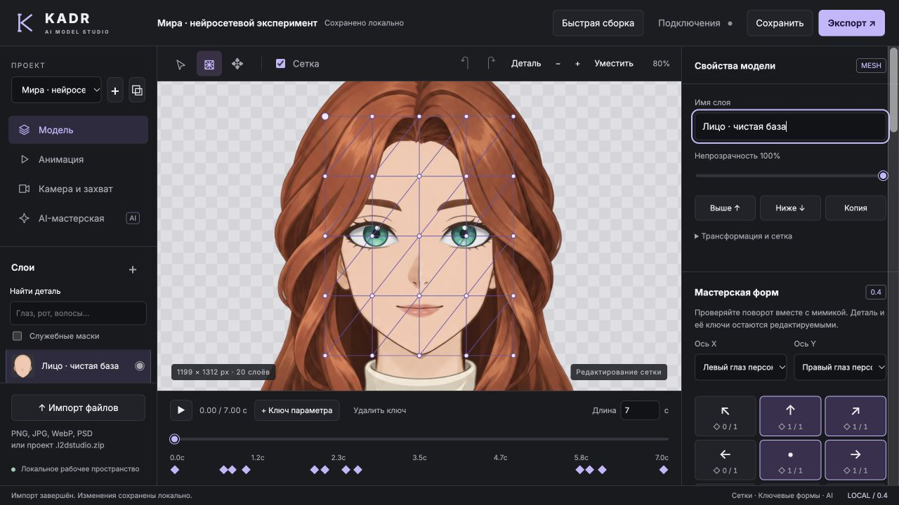

*Сетка остаётся редактируемой. Для общего наклона детали головы привязаны к вращательному деформеру, поэтому движутся согласованно.*

В Мире подготовлены девять параметров: независимое открытие глаз, взгляд по двум осям, рот, наклон головы, движение прядей, дыхание и брови. Для прядей смещение усиливается к концам, а корни остаются почти неподвижными. Дыхание слегка поднимает верх одежды. Так помощник задаёт небольшой понятный набор движений, который можно поправить вручную.

## 9. Проверить движения в сочетании

Сначала помощник меняет взгляд при открытых глазах. Затем проверяет рот одновременно с наклоном головы. Такая последовательность помогает заметить расхождение деталей, которое не проявлялось в нейтральной позе.

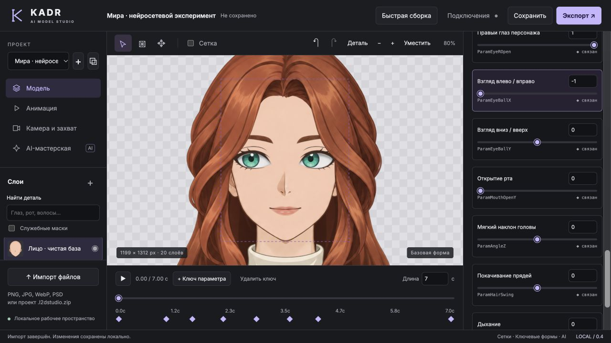

*Ползунок взгляда выставлен в край диапазона. Радужки остаются внутри глаз.*

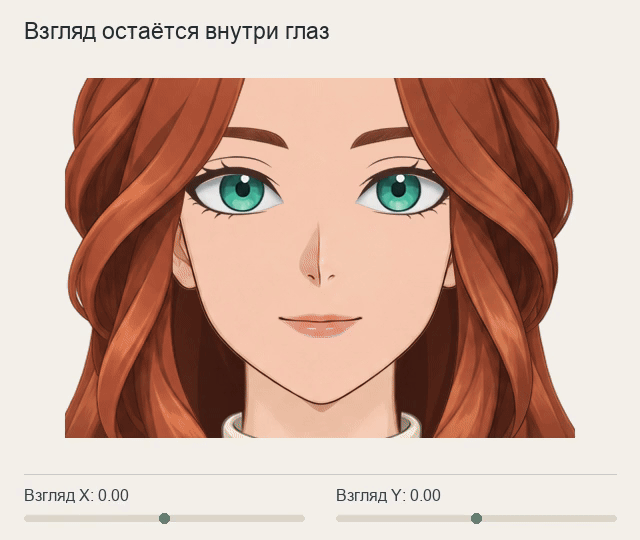

*Анимационный пример: взгляд проходит по горизонтали и вертикали при открытых глазах. Радужки остаются внутри белков. Меняются только параметры взгляда; числовые значения помогают повторить проверку.*

[Открыть видео с управлением воспроизведением](media/mira-gaze-example.mp4)

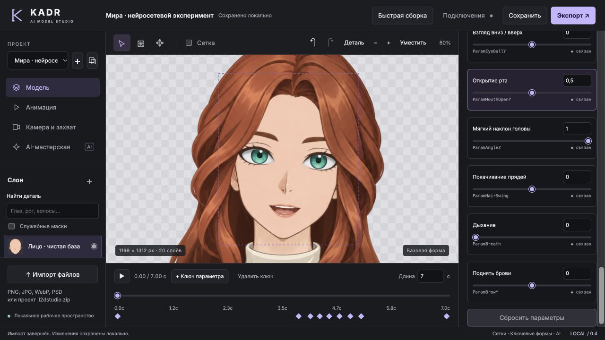

*Открытие рта — 0,5, наклон — 1. Это проверочная поза: в спокойной демонстрации амплитуды значительно меньше.*

У текущего примера голова наклоняется в плоскости рисунка. Объёмный разворот лица не создан. Рот использует две художественные формы и промежуточное изменение геометрии; синхронизации с фонемами речи в этом примере нет.

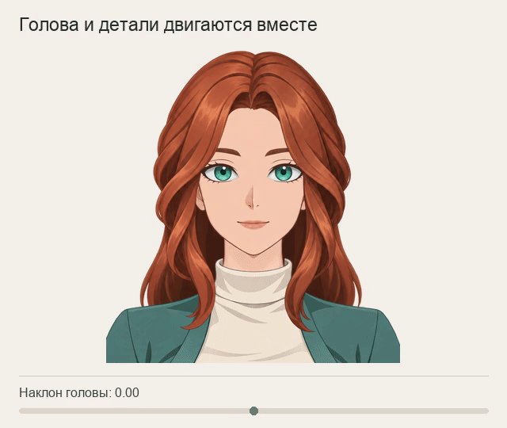

*Анимационный пример: меняется только наклон головы. Глаза, рот и волосы следуют за общим деформером. Это поворот в плоскости рисунка; объёмный разворот здесь не показывается.*

[Открыть видео с управлением воспроизведением](media/mira-tilt-example.mp4)

## 10. Собрать спокойную анимацию

Для показа помощник создаёт отдельную девятисекундную копию. В ней — лёгкое дыхание, три естественных моргания, небольшие переводы взгляда, мягкий наклон и короткое приоткрытие рта. Пряди следуют за движением с небольшим запаздыванием. Исходные рисунки и геометрия модели сохраняются.

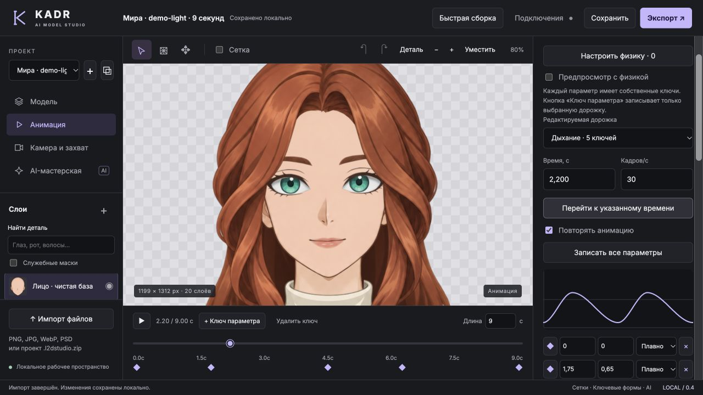

*На шкале времени выбирается конкретный момент, справа — дорожка и её ключи. Дыхание распределено на всю петлю.*

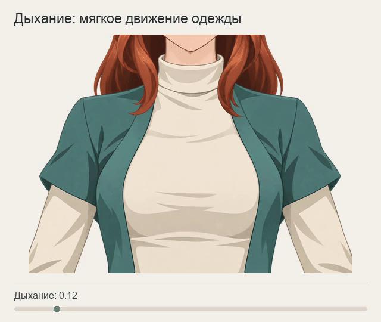

*Анимационный пример: параметр дыхания плавно меняется от 0,12 до 0,85 и обратно. На увеличении видно небольшое движение одежды. Голова, глаза и рот остаются неподвижными.*

[Открыть видео с управлением воспроизведением](media/mira-breath-example.mp4)

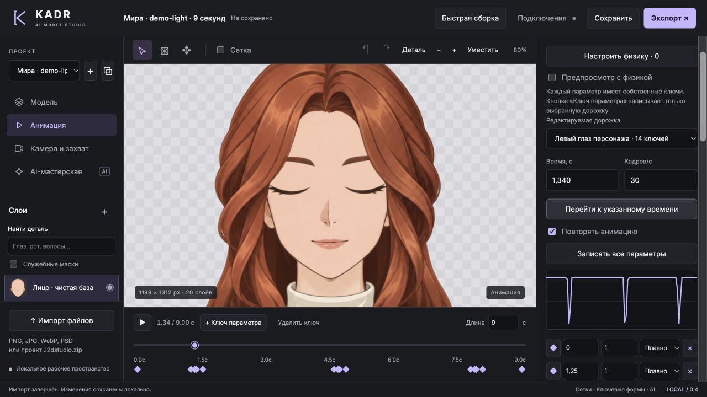

*На отметке 1,34 секунды глаза закрыты. Кривая показывает короткое закрытие и возвращение в открытое состояние.*

Запаздывание волос рассчитано пружиной Лицедей и записано в обычные редактируемые ключи. Поэтому в готовой копии для его воспроизведения не требуется включать отдельную физическую группу.

При проверке петли обнаружилась небольшая растровая дрожь на точно нулевом дыхании. Помощник немного поднял нижнее значение и повторил рендер. На скриншотах дорожек показана рабочая итерация до этой небольшой корректировки. Это пример цикла «настроить → посмотреть → исправить конкретный участок».

## 11. Экспортировать проект и открыть его обратно

Помощник выбирает экспорт полного проекта. Редактор показывает подтверждение «Файл готов» и ссылку на ZIP. В архив переходят изображения, сетки, параметры и анимация.

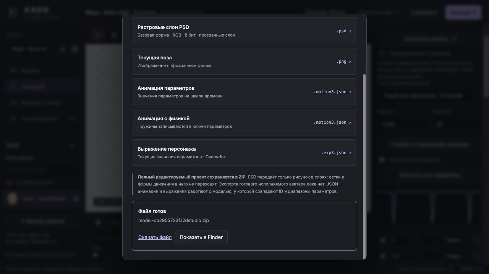

*Для продолжения работы нужен полный ZIP-проект. PNG сохраняет одну позу, а PSD передаёт растровые слои без рига.*

Следом помощник импортирует полученный архив и переходит к выбранному времени. Дорожка наклона и модель доступны после повторного открытия.

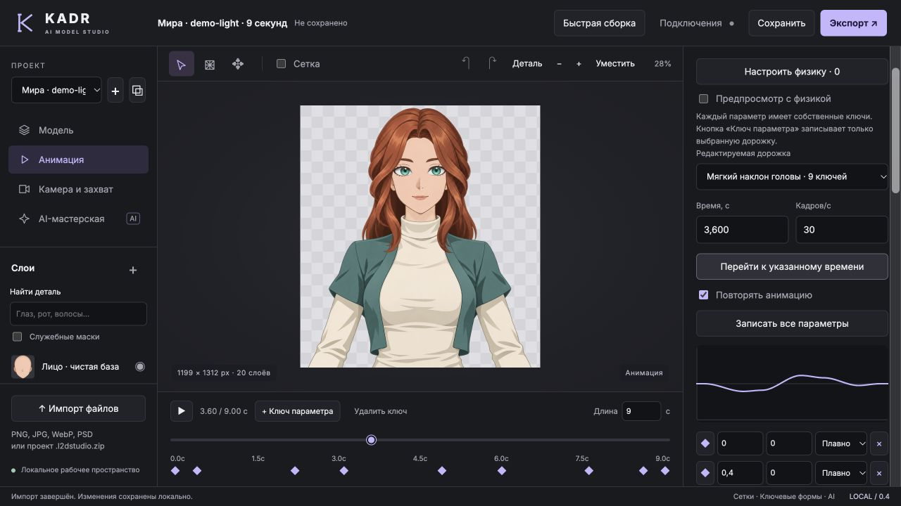

*Проверка завершает рабочий маршрут: результат можно переносить и продолжать редактировать.*

## 12. Посмотреть итоговое движение

[Открыть девятисекундное видео](media/mira-demo-light.mp4) · [Скачать редактируемый проект](examples/Mira-demo-light.l2dstudio.zip)

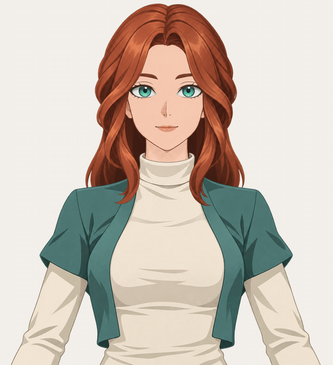

*Это рендер реальной модели: 9 секунд, 30 кадров в секунду, без звука. GIF служит компактным предпросмотром; плавность лучше оценивать по MP4.*

После повторного импорта итогового проекта совпали пиксели в 12 проверочных позах; начало и конец петли совпадают. Проверены независимость моргания и маски при нескольких степенях закрытия. В коротком переходе между открытым и закрытым веком заметно небольшое осветление контура — это оставшаяся особенность демонстрационного рига.

## Что именно ускоряет AI-помощник

| Работа | Что берёт на себя помощник | Что получает автор |
|---|---|---|
| Подготовка рисунка | Формулирует запросы для отдельных частей и скрытых участков | Набор изображений, пригодных для сборки |
| Подготовка файлов | Разделяет парные элементы, проверяет прозрачность, совмещает части | Повторяемую структуру слоёв |
| Работа в приложении | Импортирует, выбирает слои, заполняет назначения, проверяет схему | Модель с настроенной основой глаз |
| Настройка движения | Задаёт параметры, деформеры, формы и дорожки | Редактируемое движение |
| Проверка | Меняет позы, изучает промежуточные кадры, повторяет экспорт и импорт | Конкретные найденные ошибки и проверенный файл |

Помощник работает двумя способами: управляет видимым интерфейсом и выполняет пакетные операции через программные функции Лицедей. В этом разборе импорт, назначения в мастере, проверки ползунков и экспорт выполнены через интерфейс. Повторяемая сборка полной модели и расчёт кадров используют функции редактора. Нейросеть, создающая изображения, отвечает за художественные детали; решение о следующем действии принимает AI-помощник с доступом к этим инструментам.

Автор может дать поручение: «Подготовь из этого портрета модель, проверь каждый глаз отдельно, добавь спокойное дыхание и покажи скриншоты промежуточных шагов». Помощник разбивает его на операции и возвращается к проблемной детали после проверки. Человеку остаются выбор образа, желаемой выразительности и оценка результата; он может вмешаться на любом этапе.

Экономия возникает за счёт серии выполненных действий: не приходится вручную повторять назначения, подготовку файлов и одинаковые проверки для каждой части. Время ручной работы для сравнения в этом эксперименте не измерялось, поэтому обещать конкретное ускорение или гарантированный аватар за день по нему нельзя. Уже показан воспроизводимый путь к простому редактируемому персонажу с лёгкой анимацией.
